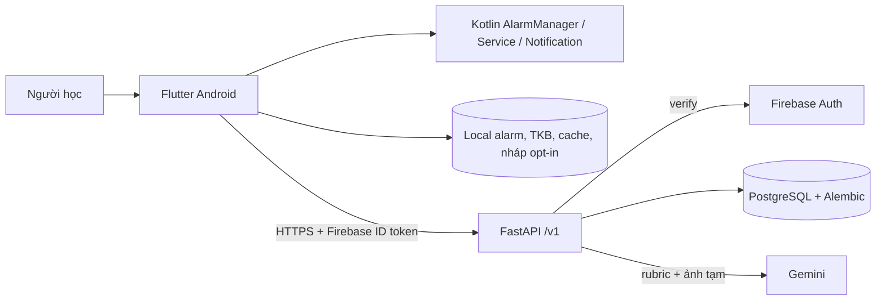

# Kiến trúc hệ thống và nguồn sự thật

**Đích:** Android Flutter + Kotlin platform code; FastAPI `/v1` + PostgreSQL + Firebase Authentication; Gemini chỉ gọi từ server. [Hiện trạng](../00-start/01-hien-trang.md) nói phần nào mới có mã. [Repo](../00-start/04-cau-truc-repo.md) nói chỗ đặt file. Không dùng Firestore làm nguồn nghiệp vụ.

## 1. Ranh giới thẩm quyền

| Dữ liệu/hành vi | Nguồn sự thật | Khi mất mạng |
| --- | --- | --- |
| Giờ reo kế tiếp, quyền OS, chuông đang kêu, Dừng/Hoãn thường | Android OS + cấu hình local | Vẫn phải dùng được; server không xác nhận OS đã schedule. |
| TKB/môn/mục tiêu trước đăng nhập | Local thiết bị | Đọc/sửa local; khi đăng nhập đồng bộ có revision/xung đột. |
| TKB/môn/mục tiêu đa thiết bị sau đăng nhập | PostgreSQL cho bản đồng bộ | Dùng bản local đã xác nhận; không âm thầm sửa chuông OS. |
| Câu, đáp án/rubric, revision, trạng thái duyệt | PostgreSQL/content pipeline | Chỉ câu offline đã đóng gói/duyệt; không tiết lộ đáp án/rubric để giả chấm. |
| Session/attempt/XP/streak/tiến độ | PostgreSQL transaction/ledger | Ghi metadata local tạm; không cấp XP/chấm bài tự do offline. |
| Game HP/giáp/skill/rank/coin | Server khi mở tính năng | Trận tạm dừng/void theo luật; client chỉ render event. |

## 2. Luồng buổi sáng

1. Người dùng xác nhận alarm; Flutter lưu cấu hình local rồi gọi MethodChannel; Kotlin kiểm quyền, lập lịch, trả `scheduled_os` hoặc mã lỗi. UI phân biệt `saved_local`, `scheduled_os`, `synced_server`.
2. Khi tới giờ, Android phát âm/rung và màn/notification theo quyền OS **trước mọi network call**. Dừng khẩn cấp tác động trực tiếp Service/receiver; việc ghi event server là hậu xử lý, không được phát lại chuông.
3. Câu cache đã duyệt được chọn theo TKB/môn/độ khó; không có câu/mạng vẫn dừng được. Người học nhập chữ hoặc chụp/xác nhận ảnh. Bài online gửi session + attempt idempotent.
4. Server xác minh token/owner/question revision/rubric, chấm deterministic trước, dùng Gemini khi cần, kiểm kết quả ba trạng thái, ghi attempt/XP/tiến độ trong transaction. Nếu `uncertain`, không phạt/cấp điểm sai.
5. Client hiển thị feedback, không tính điểm authoritative. Đồng bộ offline retry theo key, không nộp ảnh ngầm. [Alarm](02-bao-thuc-android.md), [API](04-hop-dong-api.md), [AI](06-ai-va-cham-bai.md).

## 3. Failure modes và tính nhất quán

- OS từ chối exact/full-screen/notification: lưu cấu hình nhưng báo rõ chưa đảm bảo, hướng sửa quyền; nếu fallback thì nói mức tin cậy khác. Reboot/đổi múi giờ/giờ/permission phải kiểm và lập lịch lại có idempotency local.
- API timeout: chuông/dừng/timer local tiếp tục; nháp chữ chỉ lưu khi người dùng chọn; queue metadata có TTL và không tự cấp điểm. AI timeout trả `uncertain` hoặc luồng tiếp tục an toàn; không có background grade muộn tự cấp XP.
- Submit kép: `localSessionId`, `clientAttemptId`, `Idempotency-Key` và unique SQL; cùng key/payload trả cùng kết quả, key trùng khác payload 409. Backend không tin timestamp/uid/đúng/sai/HP từ client.
- DB fail/migration sai: API fail closed cho ghi điểm/đấu, không làm kẹt Dừng khẩn cấp. Có health/metrics/backup/rollback. Production không dùng `Base.metadata.create_all()` thay Alembic migration.
- Sync hai máy: server revision và chủ sở hữu; xung đột phải hiện cho người dùng. Alarm local của máy A không được tự cho rằng đã được OS máy B lập lịch.

## 4. Phi chức năng phải đo

Độ tin cậy chuông và thời gian dừng là P0. Với API/AI: đặt timeout, rate limit, request ID, log tối thiểu, quota/cost budget; đo p50/p95 trên mạng mục tiêu. App phải hoạt động ở màn 320dp, chữ 200%, giảm chuyển động, máy yếu/offline. Không tự nêu số ms/giá khi chưa benchmark. [Kiểm thử](../03-quality/01-ke-hoach-kiem-thu.md), [vận hành](../03-quality/02-van-hanh-phat-hanh.md).
