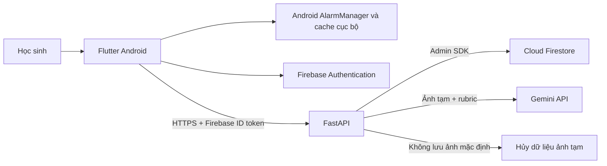
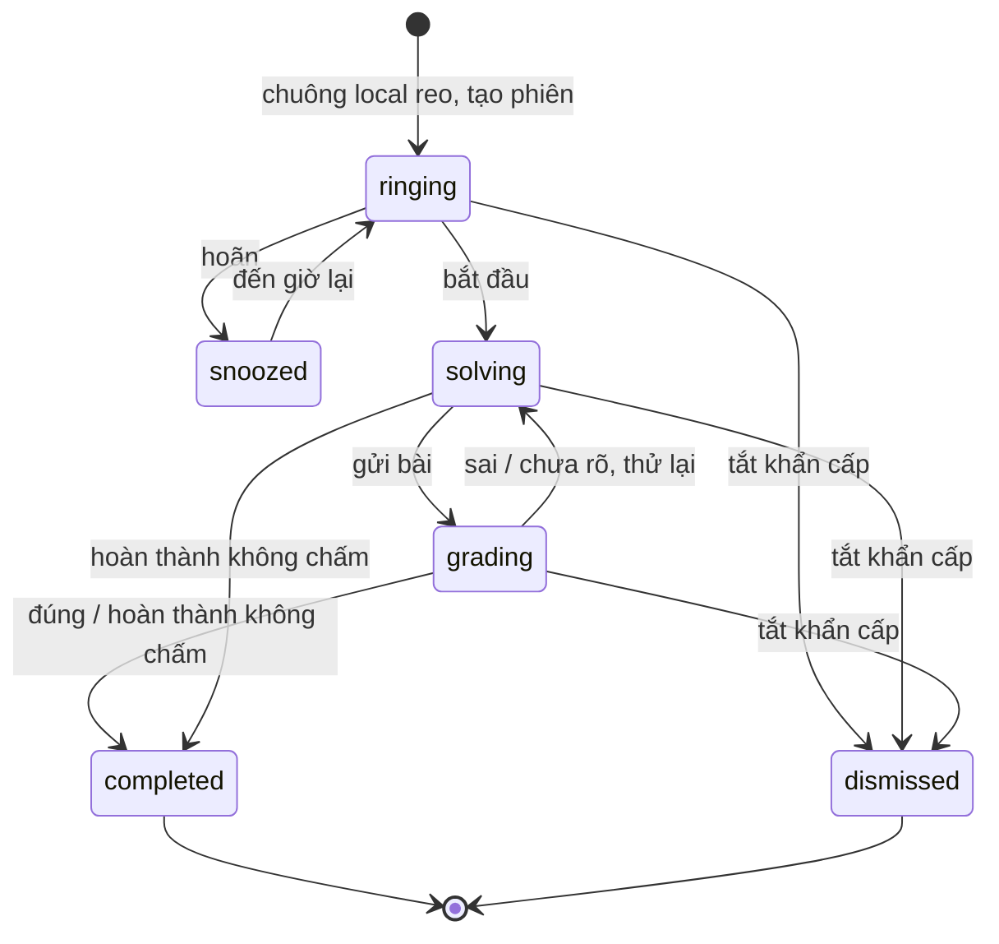

# Kiến trúc, trạng thái và mô hình dữ liệu

> **Cập nhật 11/11/2026:** [docs/28 — Backend SQL](28-backend-sql.md) thay thế quyết định Firestore và toàn bộ §5–7 về lưu trữ/vận hành CSDL trong tài liệu này. §1–4 về báo thức và máy trạng thái còn hiệu lực; sơ đồ §1 có nhãn Firestore là kiến trúc cũ. API HTTP giữ theo docs/07. Chưa có backend SQL được code.

**Quyết định nền tảng:** Flutter Android trước; lớp native Android cho `AlarmManager`/thông báo; FastAPI (Python) trên Cloud Run; Firebase Authentication; Cloud Firestore; Gemini API do backend gọi. Không dùng Firebase Realtime Database trong MVP vì dữ liệu tiến độ/câu hỏi có truy vấn và quyền theo tài liệu, Firestore phù hợp hơn. Quyết định này thay thế đề xuất stack ban đầu và phải được duyệt nếu đội đã có hạ tầng khác.

## 1. Sơ đồ hệ thống

**Nguyên tắc trách nhiệm:** thiết bị sở hữu việc reo/hoãn/tắt; server sở hữu câu hỏi, kết quả chấm, XP, dữ liệu đồng bộ; Gemini là công cụ đọc và nhận xét, không là nguồn quyết định duy nhất cho điểm. API key chỉ ở backend. Firebase ID token được backend xác minh bằng Admin SDK theo [hướng dẫn chính thức](https://firebase.google.com/docs/auth/admin/verify-id-tokens).

## 2. Vì sao Android trước và iOS sau

Android hỗ trợ báo thức người dùng qua `AlarmManager.setAlarmClock`, nhưng quyền báo thức chính xác và full-screen intent cần xử lý theo phiên bản máy; phải thử trên thiết bị thật, bao gồm máy khóa màn hình và chế độ tiết kiệm pin. [Android exact alarms](https://developer.android.com/develop/background-work/services/alarms), [Android 14 permission](https://developer.android.com/about/versions/14/changes/schedule-exact-alarms).

Apple đã có [AlarmKit](https://developer.apple.com/documentation/AlarmKit) cho iOS/iPadOS 26 với quyền và UI báo thức riêng. Giai đoạn iOS phải đánh giá AlarmKit, thiết kế đường cho phiên bản iOS cũ và kiểm thử phần cứng trước khi hứa trải nghiệm tương đương Android.

## 3. Chuẩn bị và chạy báo thức offline

1. Khi lưu báo thức, app tính lần reo tiếp theo từ giờ địa phương, múi giờ IANA và ngày lặp; yêu cầu quyền hệ thống khi cần; lập lịch cục bộ.
2. Trước buổi sáng, app tải **một snapshot câu hỏi đã duyệt** và rubric tóm tắt vào bộ nhớ mã hóa cục bộ. Nếu không tải được, dùng câu dự phòng đóng gói sẵn; nếu vẫn không có, báo thức vẫn reo.
3. Khi hệ điều hành đánh thức app, trình phát chuông và nút hoãn/tắt hoạt động **không cần đăng nhập, Internet, Firestore hay Gemini**.
4. App tạo `localSessionId` và lưu sự kiện cục bộ. Khi có mạng, backend nhận phiên theo khóa idempotency; một phiên chỉ một lần ghi XP.
5. Chụp bài → gửi backend → nhận kết quả. Mất mạng hoặc timeout không ảnh hưởng quyền tắt chuông.
6. Khi đổi múi giờ/giờ mùa hè/khởi động lại/quyền thay đổi, tính lại lịch; kiểm thử cho các thay đổi này.

## 4. Máy trạng thái phiên báo thức

`ringing`, `snoozed`, `solving`, `grading`, `completed`, `dismissed` là trạng thái phiên; `scheduled` thuộc cấu hình báo thức trước khi phiên ra đời. `grading` không được chặn nút tắt. Server chỉ chấp nhận chuyển trạng thái hợp lệ, dùng `version`/transaction để tránh hai thiết bị ghi đè. Sự kiện offline có thể đồng bộ trong 7 ngày theo chuỗi thời điểm và khóa idempotency; quá hạn vẫn giữ lịch sử local nhưng không tự cấp XP, có thể gửi phản hồi để rà soát. `snoozed` có thể lặp nhưng giới hạn theo cài đặt người dùng, mặc định 3 lần; hết giới hạn vẫn có tắt khẩn cấp.

**Hoàn thành không chấm:** chỉ cấp `+2 XP` khi server nhận được bằng chứng đã thử (một attempt ảnh đã gửi hoặc đáp án văn bản). Khi mất mạng, người học có thể nhập đáp án ngắn lưu mã hóa cục bộ để đồng bộ sau; nếu không muốn lưu, vẫn kết thúc báo thức với `0 XP`. Ảnh chụp offline không được tự động lưu vào thư viện ảnh hoặc tải lên khi nối mạng nếu người học chưa đồng ý.

## 5. Mô hình Firestore

Tất cả `createdAt/updatedAt` lưu UTC; các ngày học/streak lưu thêm `localDate=YYYY-MM-DD` và `timeZone` để tính đúng ngày địa phương. Mỗi document có `schemaVersion`.

| Collection/document | Trường chính | Chủ sở hữu/ghi |
| --- | --- | --- |
| `users/{uid}` | `displayName`, `gradeBand`, `locale`, `timeZone`, `consentVersion`, `createdAt` | User qua API; server kiểm tra |
| `users/{uid}/alarms/{alarmId}` | `localTime`, `weekdays`, `enabled`, `snoozeMinutes`, `challengeMode`, `updatedAt` | User qua API; thiết bị lưu bản local |
| `users/{uid}/timetable/{dayId}` | `weekday`, `subjects[]`, `topicIds[]`, `isSchoolDay` | User qua API |
| `question_bank/{questionId}` | `subject`, `gradeBand`, `topicId`, `difficulty`, `prompt`, `answerSpec`, `rubric`, `estimatedSeconds`, `status`, `revision` | Chỉ người biên tập/server |
| `users/{uid}/sessions/{sessionId}` | `alarmId`, `questionId`, `localDate`, `timeZone`, `state`, `attemptCount`, `finalOutcome`, `version`, timestamps | Server; client gửi sự kiện |
| `users/{uid}/sessions/{sessionId}/attempts/{attemptId}` | `submissionKind`, `result`, `evidenceSteps`, `feedback`, `confidence`, `modelVersion`, `rubricRevision`, `createdAt` | Server; **không chứa ảnh** |
| `users/{uid}/xp_ledger/{eventId}` | `sessionId`, `reason`, `delta`, `localDate`, `createdAt` | Chỉ server, transaction/idempotent |
| `users/{uid}/progress/{topicId}` | `attempts`, `correct`, `lastSeenAt`, `nextReviewAt`, `difficultyBand` | Chỉ server |
| `users/{uid}/feedback/{feedbackId}` | `sessionId`, `attemptId`, `category`, `comment`, `status`, `createdAt` | User tạo; server xử lý |

**ID:** server dùng UUIDv7/ULID hoặc random ID; `sessionId` từ client có namespace theo `uid`, được server xác thực và giới hạn độ dài. `eventId` có thể là `completion:{sessionId}` để chống cấp XP hai lần. Không dùng email/điện thoại làm document ID.

### Chỉ mục cần có

Question bank theo `(status, gradeBand, subject, topicId, difficulty)`; sessions theo `(uid, localDate desc)` qua subcollection; progress theo `nextReviewAt`. Chỉ tạo index khi truy vấn cụ thể cần, ghi vào migration/config quản lý cùng repo.

## 6. Quyền truy cập và bảo mật dữ liệu

- Client **không ghi trực tiếp** `xp_ledger`, `progress`, `question_bank`, kết quả chấm hoặc trạng thái đã hoàn thành. MVP có thể cho đọc bản dữ liệu riêng trực tiếp qua Firestore khi rules được kiểm thử; đường đơn giản hơn là toàn bộ dữ liệu qua FastAPI.
- Backend xác minh ID token và xác thực `uid` từ token, không tin `uid` trong URL/body. Vai trò biên tập câu hỏi là custom claim hoặc IAM ở công cụ quản trị riêng.
- Firestore/Storage rules bắt đầu **deny all**, mở từng quyền cần thiết và có kiểm thử emulator. [Firebase security checklist](https://firebase.google.com/support/guides/security-checklist).
- Ảnh chụp gửi multipart đến backend qua HTTPS, xử lý trong bộ nhớ/tệp tạm mã hóa; mặc định không ghi vào Cloud Storage/Firestore/log. Nếu cần lưu để rà soát chấm sai, hỏi đồng ý riêng và đặt TTL ngắn, quyền truy cập riêng.
- Mặc định giữ bản ghi attempt/feedback trong 90 ngày để người học xem lại, sau đó chỉ giữ tổng hợp tiến độ cho tới khi họ xóa tài khoản; log vận hành tối đa 30 ngày. Các thời hạn này là quyết định sản phẩm ban đầu và cần rà soát theo quy định áp dụng trước phát hành. Người học có thể yêu cầu xóa sớm.
- Có chức năng xóa tài khoản và dữ liệu liên quan, gồm phiên, tiến độ, phản hồi; khóa ngoại và bản sao lưu phải được xét trong quy trình xóa.
- Không dùng ảnh học sinh làm dữ liệu huấn luyện hoặc chia sẻ công khai theo mặc định; kiểm tra điều khoản dịch vụ AI áp dụng trước pilot.

## 7. Nền tảng và vận hành

- Môi trường `local`, `staging`, `production` tách Firebase project và Gemini key; không đưa khóa vào app/repo.
- API FastAPI triển khai Cloud Run, có health endpoint, giới hạn request, timeout và giám sát latency/error rate/cost. Không log nội dung ảnh hoặc phản hồi nguyên văn chứa dữ liệu cá nhân.
- Bộ câu hỏi là dữ liệu versioned, có người duyệt chuyên môn, changelog và cơ chế thu hồi câu lỗi.
- Cần chính sách backup/restore Firestore; backup không thay thế yêu cầu xóa dữ liệu cá nhân.
- Nếu sau này có thi đấu thời gian thực, đánh giá lại hạ tầng riêng. Không thêm Redis/Realtime Database chỉ để phục vụ MVP.

