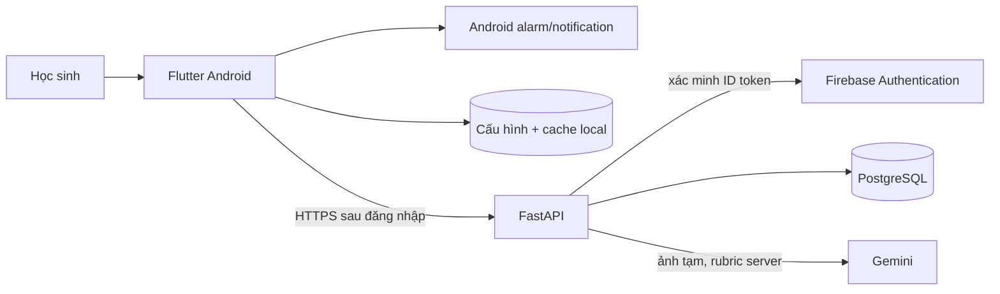

# Kiến trúc và dữ liệu MindClock

**Trạng thái:** thiết kế để coding, chưa có hệ thống chạy. [PRD](04-prd-va-dac-ta-san-pham.md) quyết định hành vi; [API](07-hop-dong-api-va-ai.md) quyết định giao tiếp; [Backend SQL](28-backend-sql.md) quyết định bảng và transaction. Tài liệu này mô tả ranh giới thành phần và quyền ghi, thay cho phương án Firestore cũ.

## 1. Thành phần và nguồn sự thật

| Dữ liệu/quyết định | Nguồn sự thật | Quy tắc |
| --- | --- | --- |
| Chuông đang reo, quyền OS, giờ reo tiếp | Android + cấu hình local | Chạy khi offline, token hết hạn và app không mở; API không thể xác nhận OS đã đặt chuông |
| Giờ học, môn, tùy chọn báo thức trên nhiều máy | PostgreSQL sau đăng nhập; local trước đăng nhập | Khi đồng bộ có revision và thông báo xung đột; sửa lịch không âm thầm đổi giờ alarm |
| Câu đã duyệt, đáp án, rubric, phiên bản | PostgreSQL | Chỉ backend thấy đáp án/rubric trước khi hoàn thành; mobile chỉ nhận prompt, yêu cầu trình bày và revision |
| Phiên/nỗ lực/XP/streak/tiến độ | PostgreSQL + ledger | Chỉ backend chốt; client không cấp điểm hay suy ra kết quả bài tự do offline |
| Bài nháp chữ chưa gửi | Thiết bị, tối đa 24 giờ nếu người dùng chọn lưu | Cô lập theo local profile, có xem/xóa, không tự tải lên; ảnh không lưu mặc định |
| Trận/rating/Đồng Mực/bảng | PostgreSQL khi giai đoạn này được mở | Server authoritative, opt-in, không dùng giờ dậy; luật ở [35](35-solo-rpg-dong-bo-va-ky-nang.md)–[40](40-dau-truong-pvp-nhan-vat-ban-do-va-hieu-ung.md) |

SQLite chỉ dành cho demo/backend local một máy. Hai máy thi online và phát hành cần PostgreSQL cùng API có thể truy cập qua mạng; demo local không chứng minh ghép trận trực tuyến.

## 2. Báo thức an toàn trước khi kết nối

Mobile lưu cấu hình báo thức trên máy và lập lịch với OS sau khi người dùng xác nhận. UI chỉ hiện `Đã sẵn sàng` sau khi kiểm tra quyền và lập lịch thành công. Khi reo, phát âm/rung trước mọi lời gọi mạng; câu đã cache hoặc câu đóng gói **do đội duyệt** là tùy chọn. Nếu không có câu, chuông vẫn reo và có thể dừng. `Dừng khẩn cấp` dừng âm/rung ngay trên thiết bị ở mọi màn, kể cả đang chấm, không cần login/API. Chế độ thử thách không có Hoãn; chế độ thường có thể có Hoãn theo [31](31-bao-thuc-thu-thach.md).

Lịch/reboot/đổi múi giờ/quyền bị thu hồi phải tính và lập lịch lại theo khả năng OS, hiển thị trạng thái quyền thực tế. Không hứa rằng app mở khóa máy, che nút Dừng hệ thống hoặc ngăn gỡ app. iOS có giới hạn riêng ở [20](20-ios-demo-va-phat-hanh.md).

## 3. Phiên và chấm bài

`local alarm ring → local session → start → [attempt/uncertain/retry]* → completed | completed_ungraded | dismissed`. Dừng chuông là tác vụ local tức thời; đồng bộ trạng thái server là bước sau. Một `localSessionId` chỉ tạo một phiên server; mọi attempt có `clientAttemptId` và idempotency key. Chỉ server kiểm tra ownership, revision, rubric, trạng thái, giới hạn nộp và ghi ledger trong transaction.

Người học gửi `answerValue` cùng `reasoningText` hoặc ảnh nháp. Backend lấy câu/rubric đã duyệt, kiểm tra đáp án có thể xác định bằng quy tắc, nhờ Gemini đọc/nhận xét khi cần, rồi tự quyết `correct | incorrect | uncertain` theo [39](39-bai-lam-co-trinh-bay-va-cham-cong-bang.md). AI không quyết XP/rank/gian lận. Ảnh được xử lý tạm, xóa cả khi lỗi; không đưa ảnh/token/lời giải cá nhân vào log. `uncertain` không tính sai hay phạt; người dùng có thể nhập chữ/thử lại/kết thúc.

Offline, bài viết tự do chỉ là `Hoàn thành không chấm`. Không chứa đáp án/rubric trong APK/cache để giả chấm; cũng không cấp XP từ đồng hồ hoặc cờ nỗ lực trên client. Bài chữ lưu để gửi sau chỉ theo lựa chọn riêng, cần xác nhận lại khi có mạng. Quy tắc XP `+2` cũng đòi server đã nhận attempt hợp lệ; xem [API §8](07-hop-dong-api-va-ai.md).

## 4. Ranh giới quyền và dữ liệu trẻ em

- Khách local đặt alarm/lịch, làm câu mẫu; không có hồ sơ server, XP/RP hoặc bảng hạng. Đăng nhập online bằng Firebase Authentication; FastAPI xác minh ID token và ánh xạ `auth_subject`, không giữ mật khẩu trong SQL. [Đăng ký](24-dang-ky-va-quan-ly-tai-khoan.md).
- Mọi request có quyền dựa trên `uid` từ token và owner SQL; client không gửi `userId`, vai trò hay điểm có thẩm quyền. DB runtime có quyền tối thiểu, không truy cập trực tiếp từ app; default deny ở API/DB và kiểm thử chéo người dùng.
- Hồ sơ/lịch/bài cá nhân riêng tư mặc định; ảnh không lưu mặc định; consent, xuất/xóa, thời hạn và đổi tài khoản máy chung theo [25](25-bao-mat-va-du-lieu.md).
- Đấu trường là tự nguyện, biệt danh/ẩn bảng, không chat tự do hay lộ trường, vị trí, giờ dậy. Học sinh không bị trừng phạt vì sai, nghỉ hoặc dừng chuông.

## 5. Hợp đồng triển khai

Một task code phải chỉ ra màn/endpoint/bảng/trạng thái nào đổi, đối chiếu [workflow](17-workflow-va-vong-doi-du-lieu.md), [tích hợp](18-huong-dan-tich-hop-api.md), [kiểm thử](09-ke-hoach-kiem-thu.md) và [nhu cầu học sinh](41-nhu-cau-hoc-sinh-va-kiem-chung-san-pham.md). Migrations, quyền truy cập, idempotency và test thiết bị thật là cổng trước pilot. Phần iOS, PvP, kinh tế game và dashboard là đặc tả giai đoạn sau, không tự mở phạm vi MVP.
