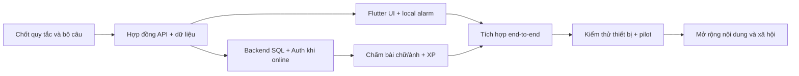

# Kế hoạch triển khai từ tài liệu đến sản phẩm

> **Cập nhật 11/11/2026:** gói `30% sản phẩm` tại [docs/29](29-ke-hoach-chuan-bi-30-phan-tram.md); nhu cầu người học và cổng kiểm chứng tại [docs/41](41-nhu-cau-hoc-sinh-va-kiem-chung-san-pham.md). Backend dùng PostgreSQL theo [docs/28](28-backend-sql.md), SQLite chỉ cho demo một máy.

**Nguyên tắc:** bản DevFest là lát cắt trình diễn; MVP là ứng dụng Android có báo thức thật, dữ liệu thật và thử 7 ngày; sản phẩm đầy đủ chỉ mở rộng sau khi đo nhu cầu. Các mốc dưới đây là **ước lượng công việc**, không phải cam kết lịch khi chưa biết số người và năng lực đội.

## 1. Thứ tự phụ thuộc

## 2. Giai đoạn D0 — DevFest, một buổi sáng

**Đầu ra:** demo theo [kịch bản thi](02-ke-hoach-thi-va-demo.md), một câu Toán lớp 9 tự biên soạn/đã duyệt có rubric; cho nhập đáp án và một bước giải bằng chữ, ảnh là đường tùy chọn; có `uncertain` và Dừng khẩn cấp. Pitch nêu rõ live và mô phỏng. Nếu thể lệ không cho chuẩn bị sản phẩm trước, chỉ dùng tài liệu và tài sản được phép.

**Chốt phạm vi:** 5 màn hình chính; báo thức mô phỏng để không chờ thời gian thật; backend Gemini nếu kịp và Internet ổn; fallback video có nhãn. D0 **không được dùng làm bằng chứng** báo thức hệ thống/AI chấm rộng đã hoàn thiện.

## 3. Giai đoạn M1 — MVP Android, đề xuất 6–10 tuần với đội nhỏ

| Sprint/gói | Công việc | Đầu ra kiểm tra được | Phụ thuộc |
| --- | --- | --- | --- |
| M1.0 nền tảng | Repo, CI, PostgreSQL/migration, local guest, Firebase Auth cho online, secret, API deny-all, bộ câu 10–20 câu đã duyệt | App mở được, API health, DB/schema test, không có key trong repo | Tài liệu hiện tại |
| M1.1 báo thức | Flutter setup, lịch, native bridge Android, quyền, lập lịch, restart/timezone, Dừng khẩn cấp và Hoãn chỉ mode thường | Chuông chạy/dừng khi app đóng/màn khóa/mất mạng trên thiết bị thử | M1.0 |
| M1.2 học tập | Lịch học, tải câu trước, câu dự phòng, UI thử thách, nhập đáp án + trình bày hoặc camera | Hoàn thành buổi sáng offline không chấm và buổi có mạng | M1.0–M1.1 |
| M1.3 server/AI | Auth verify, question bank, session/attempt, Gemini chấm, `uncertain`, XP ledger | API theo hợp đồng, test idempotency, phản hồi 3 trạng thái | M1.0 |
| M1.4 tích hợp | Đồng bộ offline, tiến độ, báo AI chấm sai, xóa dữ liệu, telemetry tối thiểu | Chạy end-to-end và xử lý lỗi mạng/quyền | M1.1–M1.3 |
| M1.5 phát hành nội bộ | Kiểm thử thiết bị, AI evaluation, bảo mật, sửa lỗi | Bản nội bộ đủ điều kiện thử 7 ngày | M1.4 |

Không tiến sang M1.4 khi nút tắt khẩn cấp chưa hoạt động ở mọi trạng thái; không tiến sang pilot nếu có báo thức bị lỡ mà chưa hiểu nguyên nhân.

Ước lượng 6–10 tuần giả định 3–4 người có thời gian làm đều, có thiết bị Android thử và quyền dùng Gemini/Firebase. Nếu đội chỉ làm ngoài giờ hoặc chưa có kinh nghiệm native Android, cần tăng thời gian. Đây là ước lượng lập kế hoạch, không phải hạn cuộc thi.

## 4. Giai đoạn M2 — pilot và chất lượng học tập

1. Tạo công cụ biên tập câu hỏi có `draft → reviewed → published → retired`, rubric và revision; mỗi câu có người duyệt chuyên môn.
2. Tăng bộ câu theo từng môn/chủ đề, ưu tiên Toán và Anh; câu hỏi viết tay chỉ dùng với dạng phù hợp.
3. Tập đánh giá AI tối thiểu 50 ảnh/nhập đáp án đa dạng; hiệu chuẩn `uncertain`, theo dõi lỗi theo loại chữ/ánh sáng.
4. Thử 7 ngày với 5–10 học sinh tự nguyện; có đồng ý phù hợp, ghi nhận khó chịu và thời gian ngủ tự báo nếu có.
5. Quyết định tiếp tục/đổi hướng dựa trên kết quả: báo thức có tin cậy không, người học có thấy giá trị không, AI có chấm đủ tốt không.

## 5. Giai đoạn M3 — tính năng mở rộng có điều kiện

| Tính năng | Điều kiện mở | Thiết kế tối thiểu |
| --- | --- | --- |
| Linh thú | Pilot cho thấy tăng động lực mà không gây áp lực | Chỉ thưởng tích cực, không “ốm” vì sai/ngủ thêm |
| Nhóm/lớp | Giáo viên và học sinh muốn dùng, quyền đồng ý rõ | Số liệu tổng hợp, không public ảnh cá nhân |
| Dashboard giáo viên | Có bộ môn/chủ đề chuẩn và dữ liệu đủ tin cậy | Chỉ số lớp được ẩn danh theo ngưỡng tối thiểu |
| Phụ huynh | Học sinh/phụ huynh đồng ý phạm vi xem | Chỉ thông tin đã chọn, thu hồi quyền dễ dàng |
| Đấu ELO | Có cơ chế chống quấy rối, cân bằng câu, bảo vệ trẻ em | Trận ngắn, ghép theo năng lực, hạn chế giao tiếp |
| iOS | Có thiết bị và người phụ trách thử AlarmKit/phiên bản cũ | Không quảng bá “báo thức giống Android” trước QA |

**Thứ tự thực thi sau Android P0:** prototype ba nhân vật gốc theo [docs/46](46-pvp-ba-nhan-vat-luat-ui-asset-networking.md) → giao hữu một round hai máy → hoàn thiện combat/cân bằng và chấm → bảng opt-in/ranked sau cổng chất lượng. **iOS là nhánh tương lai độc lập**, chỉ mở khi Android trên máy thật đã đạt P0 và có Mac/Xcode/iPhone, theo [docs/20](20-ios-demo-va-phat-hanh.md). Không đưa iOS vào điều kiện demo cuộc thi.

| ID | Gói mở rộng | Đầu ra kiểm tra được | Cổng phụ thuộc |
| --- | --- | --- | --- |
| X01 | Demo Android trên máy thật | AD01–AD09, video dự phòng có nhãn, một luồng chuông → câu → phản hồi | App Flutter/Android đã code và máy Android; [docs/47](47-demo-android-va-moi-truong-kiem-thu.md) |
| X02 | iOS tương lai | Build/AlarmKit và kiểm thử iPhone thật theo docs/20, không nằm trong demo Android | Android P0 đạt, Mac/Xcode/iPhone và người phụ trách |
| X03 | Nhân vật/asset | 3 nhân vật concept theo docs/46, avatar 48 dp, skill/FX có source và quyền | Brief docs/46, test nhận diện/cân bằng với người học |
| X04 | Giao hữu online | Hai tài khoản cùng câu, nộp một lần, chốt kết quả idempotent | Bộ câu duyệt, auth, test mạng |
| X05 | Bảng tuần | Projection theo môn/khối/tuần, opt-in/out, top 20 | X04, quyền riêng tư, ngưỡng người tham gia |
| X06 | Rating/ELO | Ledger hai phía trong transaction, khiếu nại, anti-farm | X04–X05 và cổng docs/19 |

## 6. Backlog đầu tiên để giao coding

| ID | Ưu tiên | Công việc | Điều kiện hoàn thành |
| --- | --- | --- | --- |
| T01 | P0 | Thiết lập cấu trúc repo, môi trường, CI và tài liệu chạy local | Người mới làm theo README chạy được app/API/emulator |
| T02 | P0 | Định nghĩa schema câu hỏi và nhập 10 câu Toán 9 đã duyệt | Mỗi câu có đáp án, rubric, revision, thời gian dự kiến |
| T03 | P0 | Khách local, Firebase Auth online, `/me`, SQL/API deny-all và kiểm thử quyền | Chuông không cần login; token sai/uid khác bị từ chối |
| T04 | P0 | API alarm/timetable/challenge | Contract test pass; trả đúng câu theo ngày/môn |
| T05 | P0 | Native Android alarm + quyền + local cache | Chạy khi màn khóa, mất mạng, reboot trên thiết bị đích |
| T06 | P0 | UI tiếng Việt + accessibility, chữ thay camera | Theo [UX](05-ux-va-noi-dung-tieng-viet.md) và U01–U10 ở docs/41, không kẹt luồng |
| T07 | P0 | API session/idempotency/attempt | Không có duplicate session/XP |
| T08 | P0 | Gemini đọc/chấm + validator + `uncertain` | Dùng bộ ảnh test; không trả đúng khi validator bất đồng |
| T09 | P0 | XP ledger/progress và thống kê cá nhân | Quy tắc điểm đúng, không trừ điểm sai |
| T10 | P0 | Mất mạng, timeout, tắt khẩn cấp, quyền bị từ chối | Các ca P0 trong test plan pass |
| T11 | P1 | Báo kết quả chấm sai và quy trình xóa dữ liệu | Có yêu cầu từ app đến backend, kiểm tra quyền |
| T12 | P1 | Telemetry tối thiểu và dashboard vận hành | Theo dõi lỗi/latency/chi phí không lộ PII |

## 7. Định nghĩa hoàn thành cho mỗi task

Một task hoàn thành khi: hành vi khớp PRD/UX/API; có kiểm thử phù hợp mức rủi ro; quyền truy cập và trạng thái lỗi được xử lý; tài liệu thay đổi cùng code; có hướng dẫn chạy/kiểm tra; reviewer xác nhận không làm hỏng báo thức, chấm hoặc điểm. Với mobile alarm, “chạy trên emulator” **chưa đủ**; phải có kiểm thử thiết bị thật.

## 8. Quyết định cần ghi thành ADR khi coding

ADR-001 Flutter + Android native bridge; ADR-002 PostgreSQL cho nghiệp vụ, Firebase Authentication chỉ online (quyết định ở docs/28); ADR-003 ảnh chỉ xử lý tạm; ADR-004 question bank đã duyệt; ADR-005 AI chấm với `uncertain`; ADR-006 XP server authoritative. Mỗi ADR ghi bối cảnh, lựa chọn, phương án khác, hệ quả, ngày và người quyết định. Nếu đội thay stack, sửa ADR và các hợp đồng liên quan trước khi chia việc. Mã backlog T01–T12 ở trên **không phải ID thư mục task**; khi coding dùng TNNN theo tasks/README.

