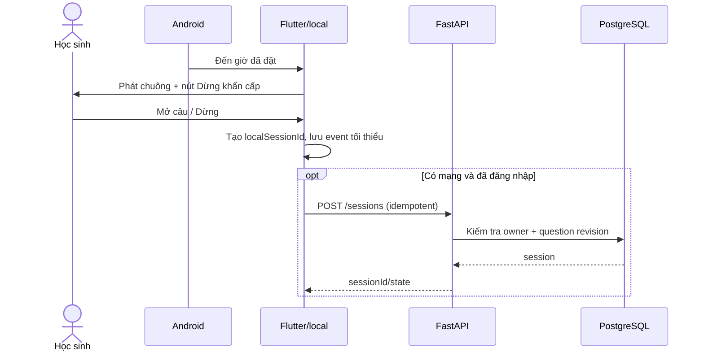

# Workflow và vòng đời dữ liệu

**Nguồn chuẩn:** [PRD](04-prd-va-dac-ta-san-pham.md), [kiến trúc](06-kien-truc-va-du-lieu.md), [API](07-hop-dong-api-va-ai.md), [SQL](28-backend-sql.md), [dữ liệu cá nhân](25-bao-mat-va-du-lieu.md). Đây là workflow dự kiến, chưa phải luồng đang chạy.

## 1. Bắt đầu không cần tài khoản

1. Học sinh chọn `Dùng thử không cần tài khoản`, nhập giờ dậy hoặc giờ vào học, thời gian chuẩn bị/đi đường và môn muốn ôn; thời khóa biểu có thể để sau. Dữ liệu nằm local theo hồ sơ thiết bị.
2. App cho xem giờ gợi ý và phép tính; chỉ người dùng xác nhận mới lưu. Không tự kéo giờ dậy sớm hơn. Xin quyền alarm/notification khi cần và lập lịch OS. Chỉ hiển thị `Đã sẵn sàng` khi có bằng chứng từ OS; nếu thiếu quyền, giải thích và vẫn cho luyện tập thủ công.
3. App thử âm chuông, hiển thị `Dừng khẩn cấp`, tải/cache prompt đã duyệt khi online. Nếu không có câu phù hợp, dùng câu đóng gói đã duyệt hoặc `Chỉ báo thức`.
4. Đăng nhập là lựa chọn khi muốn đồng bộ/XP/đấu trường. Trước nhập dữ liệu local vào tài khoản, cho xem phạm vi và xác nhận; không gộp dữ liệu của người khác trên máy dùng chung. Backend xác minh Firebase ID token, tạo/đọc `users.auth_subject`, áp dụng revision.

## 2. Chuẩn bị câu và giờ học

Khi người dùng sửa lịch hoặc mở app trước buổi học, mobile hỏi `/v1/challenges/next` với local date/môn/lớp. Backend lọc `questions.status=published`, lớp/chủ đề/mức độ hợp lệ và lịch, trả prompt + `reasoningPromptVi` + revision, **không trả đáp án/rubric**. Mobile lưu snapshot có hạn dùng và tự xác minh còn phù hợp ngày. Server giữ answer/rubric để chấm. AI có thể đề xuất giờ từ dữ liệu người dùng đã nhập, nhưng API gợi ý chỉ là preview; app kiểm phép tính và người dùng xác nhận mới thay alarm. Lịch thay đổi không tự sửa chuông.

## 3. Một buổi sáng

Phát/dừng chuông không đợi API, token hay Gemini. `Dừng khẩn cấp` hoạt động cả khi upload/chấm treo và không trừ điểm. `short_review` không có Hoãn; mode thường có thể Hoãn theo [31](31-bao-thuc-thu-thach.md). Offline có thể viết bài nhưng chỉ hiện `Hoàn thành không chấm`; ảnh không xếp hàng tải ngầm. Bản nháp chữ chỉ lưu tối đa 24 giờ nếu người dùng chọn, hỏi lại trước khi gửi. Metadata sự kiện có thể đồng bộ trong 7 ngày nhưng **không đủ để cấp XP**.

## 4. Nộp bài và chốt kết quả

1. Học sinh nhập đáp án + một cách làm ngắn hoặc chụp giấy; xem lại trước khi bấm `Gửi bài`. Camera chỉ xin quyền lúc chụp. Bài chữ offline chưa được upload khi chưa xác nhận.
2. API kiểm token, quyền session, MIME/size, revision, state, attempt ID và idempotency. Backend lấy rubric/answer từ SQL, kiểm tra đáp án có thể xác định bằng quy tắc, nhờ Gemini đọc/nhận xét khi cần, không giữ transaction mở khi chờ model.
3. Backend đối chiếu bằng validator và policy chấm; kết quả `correct`, `incorrect` hoặc `uncertain`. Bất đồng, ảnh khó đọc, thiếu bằng chứng hoặc timeout → `uncertain`; không gắn nhãn gian lận. Chế độ thử thách chỉ gợi ý phương pháp từ lần sai rõ thứ ba; `uncertain` không cộng lượt sai.
4. Transaction ngắn ghi attempt, state và ledger XP đúng một lần. `correct`/`incorrect` không do client quyết; không trả điểm thành công trước commit. Nếu phản hồi đến muộn, retry cùng key trả kết quả cũ. Ảnh tạm được xóa khi thành công/lỗi.
5. Người dùng xem lỗi đầu tiên, có thể báo chấm sai; xem lời giải sau khi hoàn thành. Bài `uncertain` không trừ XP/RP; trận ranked chưa được mở nếu bộ câu/chấm không đạt cổng ở [39](39-bai-lam-co-trinh-bay-va-cham-cong-bang.md).

## 5. Quyền ghi và lỗi

| Tình huống | Hành vi an toàn |
| --- | --- |
| OS từ chối quyền/reboot/đổi giờ | Hiện trạng thái thật; tính và lập lại lịch khi OS cho phép; test trên máy thật |
| Mất mạng/token hết hạn | Chuông local tiếp tục; bài không chấm; không hỏi đăng nhập để dừng |
| Gemini timeout/không chắc | `uncertain`, kết thúc an toàn, không cộng lượt sai/điểm đúng muộn |
| SQL transaction lỗi | Không tuyên bố XP đã cấp; retry idempotent và đối soát ledger |
| Đổi tài khoản cùng máy | Che/xóa cache cá nhân cũ theo lựa chọn; không hiện bản nháp của người trước |
| Xóa tài khoản | Thu hồi/ẩn bảng ngay; tiến trình `pending → processing → completed|failed`, báo hoàn tất khi xóa xong |

Mobile chỉ ghi cấu hình alarm và bản nháp/metadata local; backend là writer của bảng `users`, `questions`, `sessions`, `attempts`, `xp_ledger`, consent và trận. Không cho client đọc SQL trực tiếp. Quyền owner kiểm tra ở API/repository; xem [25](25-bao-mat-va-du-lieu.md). Ảnh bài không lưu mặc định, log không chứa token/ảnh/lời giải. Xuất/xóa tài khoản theo [24](24-dang-ky-va-quan-ly-tai-khoan.md)–[25](25-bao-mat-va-du-lieu.md).

## 6. Luồng hậu buổi học

Trang `Hôm nay` hiển thị một việc tiếp theo đã xác nhận, lịch học và chủ đề cần ôn; người dùng sửa/bỏ nhắc dễ. Không tự tạo nhiều task từ AI, không đẩy thông báo tụt hạng hoặc buộc mở app tối muộn. Một lỗi học tập có thể dẫn tới câu cùng kỹ năng **đã duyệt** sau giờ học; không tự sinh đề mới vào ngân hàng. Đấu trường giao hữu/bảng chỉ xuất hiện sau tự bật, không nằm trong đường dừng chuông.
