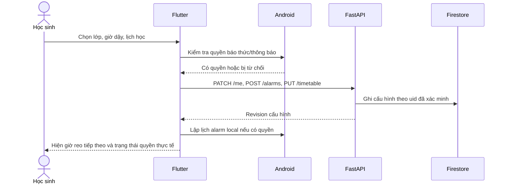
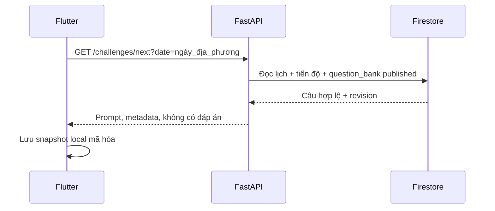
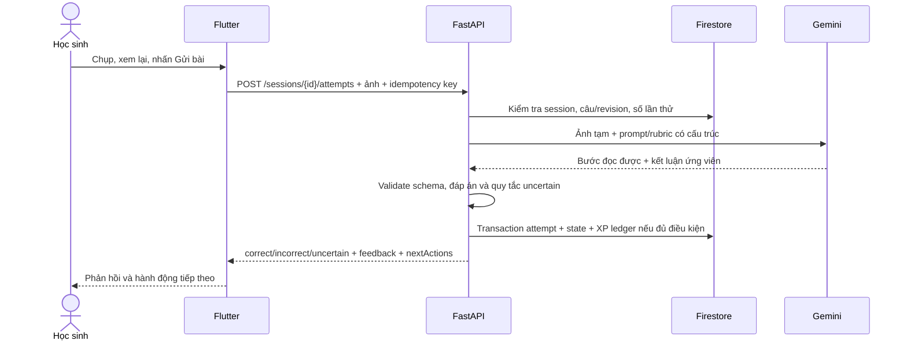

# Workflow từ mở app đến xóa dữ liệu

Tài liệu này nối [PRD](04-prd-va-dac-ta-san-pham.md), [kiến trúc/CSDL](06-kien-truc-va-du-lieu.md) và [API](07-hop-dong-api-va-ai.md). Đọc theo thứ tự khi coding một luồng end-to-end. Các trạng thái, thứ tự và quyền ghi dưới đây là hợp đồng; tên method cụ thể của SDK được chọn khi triển khai.

## 1. Onboarding và quyền

**Quy tắc:** server trả thành công không có nghĩa OS đã lập lịch. Chỉ hiện “Báo thức đã sẵn sàng” khi mobile xác minh quyền và đặt được alarm local; nếu không, hiển thị cảnh báo. Camera chỉ xin quyền lúc chụp. UID luôn lấy từ Firebase ID token đã xác minh, không từ body.

## 2. Tải câu trước và chọn dự phòng

Ưu tiên tải khi lưu báo thức và khi app mở vào chiều/tối hôm trước; không phụ thuộc một background job có thể bị OS hoãn. Nếu câu retired sau khi đã cache, server không chấm tự động câu đó mà dùng phản hồi “chưa thể chấm”; alarm local vẫn chạy. Snapshot có `validForDate`, `questionId`, `revision`; quá ngày thì không dùng làm câu chính.

## 3. Chuông reo và đồng bộ phiên

1. Android đánh thức thành phần alarm. Thiết bị phát chuông/rung và hiện màn đúng khả năng quyền OS; tạo `localSessionId` duy nhất.
2. Mobile đọc câu snapshot của ngày; thiếu câu thì dùng câu đóng gói sẵn, thiếu cả hai thì cho “chỉ báo thức”. Không gọi API trước khi phát chuông.
3. Người dùng chọn `start`, `snooze` hoặc `dismiss`. Hành động local có hiệu lực ngay; sự kiện được lưu vào hàng đợi đồng bộ.
4. Khi có mạng/token, mobile `POST /sessions` rồi `POST /sessions/{id}/events` theo thứ tự, mỗi thao tác có idempotency key cố định cho sự kiện.
5. Backend kiểm tra alarm thuộc uid, chuỗi state hợp lệ, thời điểm hợp lý, `questionRevision` và ghi transaction. Event đến lại không tạo phiên mới.

**Ví dụ sự kiện:** `ring(localSessionId, 06:30)` → `start(06:31)` → `complete_ungraded(06:33)`. `complete_ungraded` chỉ có `+2 XP` khi backend đã nhận một attempt hoặc đáp án văn bản; còn không `0 XP`. Người dùng không cần chờ đồng bộ để tắt chuông.

## 4. Chấm ảnh và ghi XP

**Không tin client:** client không gửi `correct`, `xpAwarded`, `rank`, rubric hoặc đáp án chuẩn. **Không tin model:** Gemini không ghi DB hoặc quyết định điểm. **Không giữ ảnh:** backend dọn ảnh tạm trong cả thành công và exception; Firestore chỉ có bước đã trích và phản hồi nếu người dùng đồng ý lưu kết quả học tập.

## 5. Lỗi theo từng tầng

| Tầng lỗi | Hành vi bắt buộc | Dữ liệu |
| --- | --- | --- |
| OS từ chối quyền | Cảnh báo độ tin cậy; hướng dẫn cài đặt; không giả trạng thái “đúng giờ” | Alarm config vẫn lưu, local schedule chưa sẵn sàng |
| Không mạng lúc reo | Chuông, hoãn/tắt và câu dự phòng local | Event xếp hàng, không gửi ảnh tự động |
| Không mạng lúc chụp | Cho nhập đáp án ngắn hoặc kết thúc không chấm | Chỉ lưu local có giới hạn và đồng ý; không lén upload ảnh |
| Backend 401 | Chuông local không dừng; mời đăng nhập lại sau | Event local giữ 7 ngày |
| Gemini timeout/safety block | `uncertain`, cho hoàn thành an toàn | Không ghi sai, không cấp XP đúng |
| Firestore transaction lỗi | Không trả XP thành công khi chưa commit | Retry idempotent; đối soát ledger |
| App bị kill khi đang chấm | Khi mở lại đọc phiên từ server nếu có; local alarm vẫn tắt được | Không tạo attempt mới với key cũ |

## 6. Mô hình đọc/ghi CSDL

| Dữ liệu | Nguồn chuẩn | Ai được ghi | Client được đọc gì |
| --- | --- | --- | --- |
| Hồ sơ/lịch/báo thức | Firestore + bản local cho alarm | Backend thay mặt người dùng | Chỉ dữ liệu của mình |
| Câu hỏi/rubric | `question_bank` | Biên tập viên có quyền, qua công cụ kiểm duyệt | Chỉ prompt của câu published, không có đáp án trước khi kết thúc |
| Phiên/attempt | Firestore | Backend sau kiểm tra trạng thái | Chỉ phiên của mình, không có ảnh gốc |
| XP/streak/progress | Ledger + bản tổng hợp server | Backend transaction | Chỉ dữ liệu của mình |
| Ảnh bài làm | Bộ nhớ/tệp tạm backend trong request | Upload có chủ đích từ người dùng | Preview local; không đọc lại từ DB |
| Telemetry | Hệ vận hành | Client/server tối thiểu hóa | Không dùng làm điểm học tập |

**Firestore thiết kế theo truy vấn:** tài liệu câu hỏi chung có index theo lớp/môn/chủ đề/độ khó; phiên/attempt đặt dưới user để cô lập quyền; điểm có ledger để sửa/đối soát; báo cáo lớp tương lai dùng aggregate riêng, không quét toàn bộ ảnh/attempt của trẻ em mỗi lần xem.

## 7. Vòng đời dữ liệu

Ảnh preview tồn tại trên máy cho tới khi người dùng hủy/gửi, không tự vào thư viện; ảnh trên server chỉ trong request. Attempt/feedback dự kiến 90 ngày, log kỹ thuật 30 ngày, progress giữ đến khi xóa tài khoản theo [kiến trúc](06-kien-truc-va-du-lieu.md). Khi người dùng xóa tài khoản: ngừng đăng nhập, hủy alarm local, bắt đầu job xóa dữ liệu có `deletionRequestId`, hiển thị trạng thái; không nói “đã xóa” khi job chưa xong. Rà soát backup/retention và quy định áp dụng trước phát hành.

## 8. Checklist tích hợp end-to-end

- Tạo alarm → local schedule thành công → đúng `nextFireAt` trên app.
- Tắt mạng → chuông reo → start → hoãn/tắt vẫn được → khi mạng trở lại sync một lần.
- Chụp bài sai → AI chỉ đúng bước → thử lại đúng → một ledger entry theo mức XP phù hợp.
- Gửi lại cùng request/key → cùng kết quả, không nhân đôi attempt/XP.
- Ảnh mờ/API lỗi → `uncertain`, không phạt, không mắc kẹt.
- User khác truy cập ID session → bị từ chối, không lộ metadata.
- Thu hồi quyền OS/reboot/đổi giờ → app phản ánh trạng thái thật.

