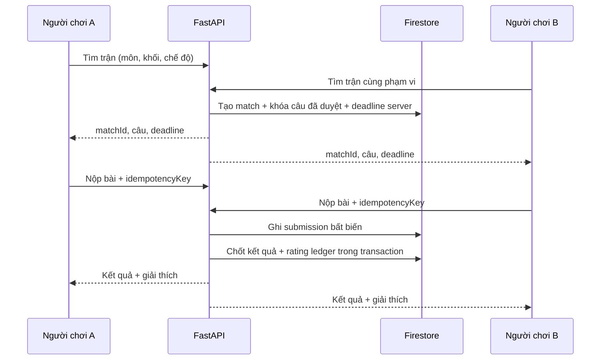

# Đấu trường trực tuyến và bảng xếp hạng — đặc tả v1

> **Solo 1v1 cập nhật:** [docs/33](33-dau-truong-solo-ranked-gdd.md) thay luật một câu/ưu tiên người nộp nhanh trong §4–5 bằng trận ba vòng, mỗi vòng một câu, không tính điểm tốc độ ở bản đầu. [docs/34](34-ngan-hang-cau-hoi-da-mon.md) là nguồn chuẩn câu hỏi và bộ ngôn ngữ; dùng SQL theo docs/28. Phần nhóm/bảng học tập tuần trong tài liệu này vẫn là định hướng mở rộng.

> **Cập nhật CSDL:** luật trận/bảng giữ nguyên; các đoạn Firestore/projection/collection dưới đây là thiết kế trước khi chọn SQL. Khi coding dùng bảng, index và transaction trong [docs/28](28-backend-sql.md).

**Trạng thái:** giai đoạn sau MVP. Thi đấu là lựa chọn riêng trong app, không tự mở khi chuông reo. Bản đầu là **giao hữu không tính hạng**. Chỉ bật rating/xếp hạng khi đạt cổng ở [kiểm toán](19-kiem-toan-khoang-trong.md).

## 1. Mục tiêu và ranh giới

- Người học chọn môn/khối/chủ đề rồi đấu 1v1 hoặc làm thử thách tuần cùng nhóm; học xong xem đáp án và gợi ý, không chỉ xem thắng thua.
- Không thưởng cho việc thức dậy sớm hơn người khác. Không dùng giờ báo thức, thời gian ngủ, địa điểm hay tên trường để xếp hạng.
- Không chat tự do giữa học sinh trong v1; chỉ dùng câu động viên có sẵn hoặc tắt tương tác.
- Không lấy kết luận AI trên ảnh mơ hồ làm cơ sở trừ điểm. Không trừ XP khi sai câu, thua trận hay bỏ một ngày.

## 2. Bốn chỉ số tách biệt

| Chỉ số | Dùng để làm gì | Quy tắc |
| --- | --- | --- |
| XP | Tiến trình học cá nhân và phụ kiện linh thú | Ghi một lần trên server cho sự kiện hợp lệ; không đổi ra tiền/lợi thế học |
| Chuỗi ôn tập | Số ngày có hoạt động học tự chọn | Không gắn nhãn kỷ luật/sức khỏe; có thể ẩn; nghỉ không bị phạt |
| Hạng học tập | Mốc cosmetic dựa XP tích lũy | Học viên → Đồng → Bạc → Vàng → Bạch Kim → Kim Cương; “Học Bá Thần Thoại” là huy hiệu mùa, không phải nhãn trí tuệ |
| Điểm đấu trường | Rating cho 1v1 có hạng theo môn và khối | Khởi tạo riêng; chỉ đổi sau trận được xác thực; không dùng làm độ khó câu buổi sáng |

**Bật rank:** trang Hồ sơ → `Thành tích` → `Tham gia đấu trường` (mặc định tắt) → chọn biệt danh, môn và khối → xem quyền hiển thị → xác nhận. Hạng học tập tự hiển thị riêng tư; bảng công khai chỉ xuất hiện sau opt-in. Người dùng có thể rời bảng ngay; rating lịch sử giữ nội bộ theo thời hạn dữ liệu, không hiện công khai. Trẻ em dưới ngưỡng tuổi chính sách chỉ tham gia khi quy trình đồng ý đã hoàn tất; trước đó chỉ giao hữu riêng tư với tài khoản thử do đội quản lý.

## 3. Chế độ chơi

| Chế độ | Đầu vào | Kết quả | Khi mở |
| --- | --- | --- | --- |
| Luyện một mình | Môn, khối, chủ đề, mức khó | Gợi ý + tiến bộ riêng | Sau MVP học tập |
| Giao hữu 1v1 | Hai tài khoản opt-in, cùng môn/khối, đề đã duyệt | Thắng/hòa/chưa chấm; không đổi rating | Pha cộng đồng đầu |
| Solo có hạng | Matchmaking theo rating môn/khối, bộ câu hiệu chuẩn | Rating ledger + bảng mùa | Chỉ sau cổng chất lượng |
| Thử thách nhóm tuần | Nhóm tự nguyện, mục tiêu câu hợp lệ | Điểm bình quân có trần/người/ngày | Sau kiểm thử quyền riêng tư |

Không ghép học sinh khác khối hoặc câu chưa hiệu chuẩn vào trận có hạng. Bắt đầu với Toán theo một khối, sau đó mở từng môn nếu có người duyệt nội dung và đủ câu. Văn/Sử bài mở dùng luyện tập hoặc phản hồi sư phạm, chưa tính rating nhị phân.

## 4. Luồng trận 1v1



Máy trạng thái: `queued → matched → active → grading → settled`; nhánh `cancelled` (chưa bắt đầu, đối thủ mất kết nối), `voided` (lỗi đề/chấm), `needs_review` (AI chưa chắc hoặc khiếu nại). Chỉ `settled` được ghi rating. **Với Solo ba vòng:** một lần nộp/người/**vòng**, backend chấp nhận lặp cùng `idempotencyKey` nhưng không chấm hay tính điểm lại. Chốt hạn theo đồng hồ server, không dựa đồng hồ máy. Hai người nhận cùng bộ ba câu; che đáp án từng câu đến khi cả hai nộp hoặc hết hạn. Đoạn luật giao hữu một câu phía dưới chỉ là phương án cũ, không áp dụng cho Solo ranked v1.

### Luật kết quả giao hữu đề xuất

1. **Giao hữu một câu cũ:** câu có đáp án kiểm chứng được, cùng đề, cùng giới hạn thời gian. **Solo ba vòng mới** tính 1 điểm/câu đúng, không thưởng tốc độ; cùng tổng điểm là hòa theo [docs/33](33-dau-truong-solo-ranked-gdd.md).
2. Mất kết nối sau `matched` trước khi hiển thị đề: hủy, không phạt. Mất kết nối trong trận: cho gửi lại cùng khóa trước deadline; sau deadline có `forfeit` chỉ nếu có bằng chứng kết nối/hiển thị đủ, nếu không `voided`.
3. AI `uncertain`, ảnh không đọc được, lỗi rubric hoặc tranh chấp: `needs_review`/`voided`; rating không đổi. Ảnh không được giữ mặc định; muốn khiếu nại ảnh cần xin phép lưu tạm với thời hạn rõ, hoặc chấp nhận hủy trận.
4. Chấm tự động chỉ cho câu có đáp án chính xác/cấu trúc rõ; Gemini có thể giải thích bước, nhưng backend/rubric quyết định trạng thái hợp lệ. Không dùng tốc độ chụp ảnh làm tiêu chí thắng khi ảnh cần AI đọc và mạng biến động.

## 5. Rating và mùa giải

- V1 giao hữu không cần ELO. Khi có hạng, rating riêng theo `{subject, gradeBand, seasonId}`; khởi tạo 1000 là **giá trị thiết kế**, cần mô phỏng trước release.
- Công thức ELO `R' = R + K(S - E)`, `E = 1/(1+10^((R_opponent-R)/400))`; `S = 1/0.5/0`. Bắt đầu K=24 là giả định để thử, không cố định khi chưa đánh giá biến động và lạm dụng.
- Chỉ chốt hai ledger cùng một transaction: `ratingBefore`, `delta`, `ratingAfter`, `matchId`, `ruleVersion`, `settledAt`. Một `matchId` không thể ghi hai lần.
- Mùa kéo dài 4 tuần thử nghiệm; đóng mùa tạo snapshot bảng, sau đó mùa mới. Không làm giảm XP hay rank học tập. Bảng có nhãn `đang cập nhật` cho đến khi projection đồng bộ.
- Không ghép liên tục cặp tài khoản để farm điểm; giới hạn số trận có hạng/ngày và số trận tính điểm với cùng đối thủ, giám sát bất thường. Không công khai cờ nghi ngờ hoặc tự gán nhãn gian lận.

## 6. Bảng xếp hạng

| Bảng | Phân vùng | Điểm xếp | Tie-break | Hiển thị |
| --- | --- | --- | --- | --- |
| Học tập tuần | Môn, khối, tuần, nhóm đủ quy mô | Điểm câu hợp lệ có trần/ngày | Cùng điểm cùng hạng; không xét giờ dậy | Top 20 + vị trí của tôi; biệt danh/avatar |
| Solo mùa | Môn, khối, mùa | Rating đã chốt | Cùng rating cùng hạng; sau đó số trận hợp lệ để thứ tự hiển thị | Top 20 + vị trí của tôi; opt-in |
| Nhóm tuần | Môn, khối, tuần; nhóm đủ thành viên | Tổng điểm thành viên có trần / số thành viên đủ điều kiện đã đăng ký trước kỳ | Cùng điểm cùng hạng | Tên nhóm đã duyệt; không nêu người nghỉ |

Điểm học tập tuần đề xuất: mỗi câu hợp lệ đã hoàn thành = 10; đúng rõ ràng = +5; tối đa 3 câu và 45 điểm/ngày; `uncertain` được 10 điểm tham gia, không +5. Điểm này **khác XP**, có `scoreRuleVersion`. Không tính lại bằng dữ liệu client. Bảng chỉ tạo khi có tối thiểu 10 người tự tham gia trong phân vùng; nếu ít hơn, chỉ hiện thành tích cá nhân và lời “Chưa đủ người để mở bảng tuần này”. Số 10 là ngưỡng thiết kế bảo vệ quyền riêng tư, cần kiểm tra theo pilot.

Firestore đọc bảng từ projection `leaderboard_entries` có index `{boardId, score desc, uid asc}` và `limit(20)`; không quét toàn bộ submissions mỗi lần. Firestore hỗ trợ [order/limit](https://firebase.google.com/docs/firestore/query-data/order-limit-data) và [transaction](https://firebase.google.com/docs/firestore/transaction-data-contention), nhưng một document tổng nóng dễ tranh chấp nên dùng ledger sự kiện + worker cập nhật entry từng người, snapshot định kỳ. Client không được ghi entry/rating. Với người dùng rời bảng, projection xóa/ẩn trong thời hạn mục tiêu dưới 5 phút; API kiểm tra opt-in lúc đọc để tránh hiện dữ liệu cũ.

## 7. Mô hình dữ liệu đề xuất

```text
competition_profiles/{uid}   {alias, avatarId, optedIn, gradeBand, subjects[], visibility, consentVersion}
question_pools/{questionId}   {subject, gradeBand, topicId, difficulty, rubricVersion, approvedBy, status}
match_queue/{ticketId}        {uid, subject, gradeBand, mode, ratingBand, createdAt, expiresAt}
matches/{matchId}             {mode, subject, gradeBand, questionId, state, deadlineAt, ruleVersion, createdAt}
matches/{matchId}/players/{uid} {joinedAt, seenAt, submittedAt, answerStatus, latencyClass}
submissions/{submissionId}    {matchId, uid, attemptKey, answerRef, gradeStatus, reviewState, createdAt}
rating_ledger/{matchId_uid}   {uid, scope, before, delta, after, ruleVersion, settledAt}
score_ledger/{eventId}        {uid, boardId, sourceId, points, ruleVersion, createdAt}
leaderboard_entries/{boardId_uid} {aliasSnapshot, avatarId, score, rankHint, updatedAt}
boards/{boardId}              {type, subject, gradeBand, period, visibility, status, memberCount}
groups/{groupId}              {name, gradeBand, ownerId, joinCodeHash, status}
group_memberships/{groupId_uid} {role, joinedAt, leftAt, consentVersion}
```

Không lưu ảnh bài làm ở `submissions`; `answerRef` là tham chiếu tạm hoặc dữ liệu trả lời đã tối thiểu hóa. `aliasSnapshot` được sửa/xóa khi đổi biệt danh hoặc rút consent. TTL và chính sách xóa phải thống nhất với [vòng đời dữ liệu](17-workflow-va-vong-doi-du-lieu.md).

## 8. API contract v1 dự kiến

Tất cả endpoint cần Firebase ID token, kiểm tra quyền ở backend; `POST` có `Idempotency-Key` khi tạo trận/nộp. Response lỗi dùng envelope của [API gốc](07-hop-dong-api-va-ai.md).

| Method/path | Mục đích | Input chính | Output chính |
| --- | --- | --- | --- |
| `PUT /v1/competition/profile` | Opt-in/out, alias, avatar, môn | `optedIn`, `alias`, `subjects`, `consentVersion` | Profile và trạng thái quyền |
| `POST /v1/matches/queue` | Ghép trận | `subject`, `gradeBand`, `mode` | `ticketId`, `status` |
| `DELETE /v1/matches/queue/{ticketId}` | Hủy tìm trận | không | `cancelled` |
| `GET /v1/matches/{matchId}` | Trạng thái và đề của mình | không | đề, deadline, state; không lộ bài đối thủ |
| `POST /v1/matches/{matchId}/submissions` | Nộp một lần | câu trả lời, `Idempotency-Key` | `accepted/needs_review`, `submissionId` |
| `GET /v1/matches/{matchId}/result` | Kết quả khi chốt | không | outcome, giải thích, rating delta nếu có |
| `GET /v1/boards/{boardId}?limit=20&cursor=...` | Top theo môn/khối/tuần | cursor hợp lệ | entries, myPosition, updatedAt, status |
| `POST /v1/matches/{matchId}/appeals` | Báo lỗi chấm | lý do, tùy chọn consent lưu chứng cứ tạm | `appealId`, SLA |

Mã lỗi đặc thù: `COMPETITION_NOT_ENABLED`, `CONSENT_REQUIRED`, `BOARD_NOT_READY`, `QUESTION_UNAVAILABLE`, `MATCH_EXPIRED`, `SUBMISSION_ALREADY_FINAL`, `RESULT_UNCERTAIN`, `RATE_LIMITED`. `GET match` chỉ đọc được bởi người trong trận; `GET board` chỉ khi board mở và người gọi đủ quyền. Các điều kiện tối thiểu: P95 lấy bảng <1 giây cho 20 dòng ở pilot, chốt giao hữu <5 giây khi chấm cấu trúc, rating settle idempotent 100%; ngưỡng cần đo thực tế.

## 9. Kiểm thử bắt buộc

- Hai máy/tài khoản online, cùng câu, deadline server; một máy chậm 2–5 giây, đồng hồ máy sai, mất mạng rồi gửi lại.
- Hai lần nộp đồng thời và worker retry: đúng một result, một ledger/người, rating bảo toàn tổng cho trận chuẩn.
- AI `uncertain`, ảnh mờ, rubric lỗi, câu sai: `voided/needs_review`, không đổi rating; sửa kết quả có audit.
- Opt-out/đổi alias/rời nhóm: không còn tên cũ trong bảng/cache/API; không xem được dữ liệu người khác.
- Top 20 và trang tiếp theo ổn định khi nhiều người đồng điểm; snapshot đóng mùa không biến đổi.
- Tài khoản mới/farm với cùng đối thủ, bot nộp liên tục, gửi `uid` giả, truy cập match ngoài quyền đều bị chặn.

