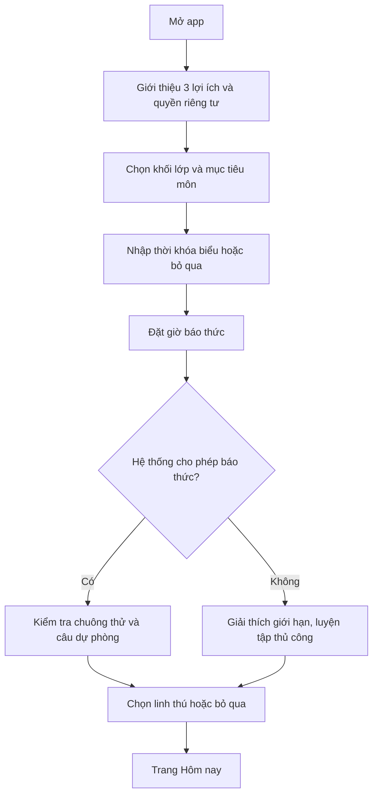
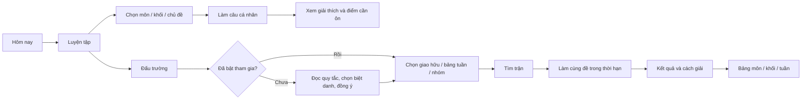

# Hành trình sử dụng MindClock và quyết định màn hình

> **Nguồn hiện hành:** [Báo thức thử thách](31-bao-thuc-thu-thach.md) không có Hoãn và chỉ gợi ý sau lần sai rõ thứ ba; [hồ sơ nhiều môn](32-ho-so-hoc-tap-va-nhieu-mon.md) chọn câu theo lịch/mục tiêu; [nhu cầu học sinh](41-nhu-cau-hoc-sinh-va-kiem-chung-san-pham.md) định nghĩa những đường thoát và thử khả dụng.

**Cấu trúc điều hướng đề xuất:** 4 tab chính `Hôm nay`, `Luyện tập`, `Đấu trường`, `Tôi`; báo thức là luồng hệ thống đi vào `Hôm nay/Thử thách`. Chỉ hiển thị `Đấu trường` như lời mời khi tính năng đã mở cho cohort; không đặt bảng xếp hạng ngay trên trang báo thức.

## 1. Người dùng mới

Chỉ xin quyền báo thức khi lưu giờ; quyền camera khi chụp lần đầu; quyền tham gia bảng khi người dùng bấm bật. Không ép đăng nhập để chuông cục bộ hoạt động; đồng bộ/đấu trường yêu cầu tài khoản. Trên iOS cũ hơn 26, UI ghi rõ `Nhắc ôn tập` thay vì `Báo thức hệ thống` theo [iOS spec](20-ios-demo-va-phat-hanh.md).

## 2. Buổi sáng

1. Chuông reo; hiển thị giờ, môn theo lịch, đề đã cache. Ở chế độ thử thách có **Mở câu hỏi** và **Dừng khẩn cấp**, không có Hoãn; chế độ thường có thể có Hoãn. Dừng luôn sử dụng được.
2. Bắt đầu thử thách: chọn **Nhập đáp án và cách làm** hoặc **Viết tay và chụp**. `Làm sau` chỉ xuất hiện sau khi đã Dừng chuông, không thay chức năng Dừng khẩn cấp. Với môn không phù hợp chụp, chỉ hiện phương thức thích hợp.
3. Chụp: hướng dẫn đặt giấy trong khung → xem lại → đồng ý gửi ảnh tạm để chấm. Không upload trước khi người dùng xác nhận.
4. Kết quả: `Đúng` → bước đã nhận, XP nếu hợp lệ; sai rõ lần 1–2 → thử lại không gợi ý; sai rõ từ lần 3 → một gợi ý phương pháp; `Chưa đọc rõ` → chụp lại/nhập tay, không tăng số lần sai. Nút Dừng khẩn cấp vẫn có trên mọi trạng thái chuông.
5. Sau hoàn thành: tóm tắt chủ đề và lịch học; linh thú chúc mừng nỗ lực; mời ôn thêm, không tự kéo vào trận đấu.

## 3. Từ luyện tập sang đấu trường

**Màn Đấu trường v1:** tiêu đề `Đấu trường học tập`; card `Giao hữu 1v1`; lọc môn/khối; card `Bảng tuần` có nhãn cập nhật; lời nhắc `Thi đấu là tùy chọn`. Khi chưa đủ người: `Chưa đủ người để mở bảng tuần này. Bạn vẫn có thể luyện cùng bạn bè.` Khi không có đối thủ sau 30 giây: `Chưa tìm thấy bạn cùng môn. Thử giao hữu với mã mời hoặc luyện một mình.` Mã mời chỉ ghép với người đã có tài khoản, có hạn dùng, không lộ thông tin cá nhân.

**Màn trận:** tên hiển thị hai bên, môn/khối, câu, thời hạn server, nút nộp; không hiện đáp án hoặc trạng thái đúng/sai của đối phương trước chốt. Khi đang chấm: `Đã nhận bài. Đang kiểm tra kết quả.` Khi AI chưa rõ: `Trận này chưa đủ cơ sở tính hạng; chúng mình sẽ cho bạn xem cách giải.`

**Màn bảng:** chọn `Môn` → `Khối` → `Tuần/Mùa`; top 20, vị trí của tôi, ngày cập nhật, giải thích cách tính điểm, nút `Ẩn tôi khỏi bảng`. Không tự động cuộn người dùng tới vị trí thấp và không thông báo “tụt hạng”.

## 4. Chọn nhân vật và rank

- `Tôi` → `Linh thú` → chọn **một nhân vật miễn phí** trong ba mẫu sprite 2D, xem bộ ba kỹ năng, nhấn `Chọn nhân vật`; nhân vật còn lại hiện giá **300 Đồng Mực**, nút `Xem thử` và `Mở bằng Đồng Mực` theo [docs/37](37-kinh-te-rank-va-nhan-vat-2d.md). Có `Đổi sau` và `Tắt linh thú`.
- `Tôi` → `Thành tích` hiển thị **XP và hạng học tập** trước, kèm mốc kế tiếp; **RP đấu trường** nằm thẻ riêng chỉ khi bật tham gia, có nhãn `Đồng 1–5` theo môn/lớp. Tooltip: `XP ghi nhận quá trình học; RP chỉ tính từ trận có hạng; Đồng Mực dùng để mở nhân vật.`
- Khi đạt mốc XP, thông báo `Bạn đã mở phụ kiện mới` và cho xem sau; không ép mở màn thưởng lúc sáng sớm.
- `Cài đặt` → `Riêng tư & thi đấu` → bật/tắt hiện trên bảng, đổi biệt danh, rời nhóm, yêu cầu xóa dữ liệu. Tắt tham gia không tắt báo thức/học tập.

## 5. Bảng trạng thái cần UI chuẩn bị

| Tình huống | Hiển thị | Hành động |
| --- | --- | --- |
| Mất mạng lúc chuông reo | `Báo thức vẫn hoạt động. Bài làm này chưa được chấm.` | Dừng khẩn cấp/Làm offline; bài chữ chỉ gửi sau khi người dùng xác nhận, Hoãn chỉ ở mode thường |
| Camera bị từ chối | `Bạn có thể nhập đáp án thay vì chụp ảnh.` | Nhập tay/Mở cài đặt quyền |
| AI chấm chưa chắc | `Ảnh này chưa đủ rõ để kết luận.` | Chụp lại/Nhập tay/Hoàn thành |
| Bảng chưa đủ người | `Chưa đủ người để mở bảng tuần này.` | Luyện cá nhân/Quay lại |
| Match timeout | `Trận đã kết thúc; điểm hạng không đổi.` | Xem lý do/Thử lại |
| Rút khỏi bảng | `Tên bạn đã được ẩn. Tiến bộ cá nhân vẫn còn.` | Xong |
| Từ chối quyền iOS AlarmKit | `iPhone chưa cho phép báo thức. Bạn vẫn có thể luyện tập.` | Mở cài đặt/Để sau |

## 6. Tiêu chí nghiệm thu luồng

- Người mới đặt giờ và biết chuông đã được OS chấp nhận hay chưa trong ≤3 phút, không cần biết thuật ngữ AI/AlarmKit.
- Hoàn thành một câu bằng nhập tay khi không có camera/mạng; luôn dừng chuông được.
- Bật bảng phải có thao tác rõ; người dùng hiểu ai nhìn thấy biệt danh và cách ẩn.
- Từ bất kỳ màn đấu trường trở về `Hôm nay` trong tối đa hai thao tác; không có chat tự do.
- UI dùng tiếng Việt tự nhiên, đầy đủ nhãn VoiceOver/TalkBack và cỡ chữ lớn; mascot không che hành động chính.

