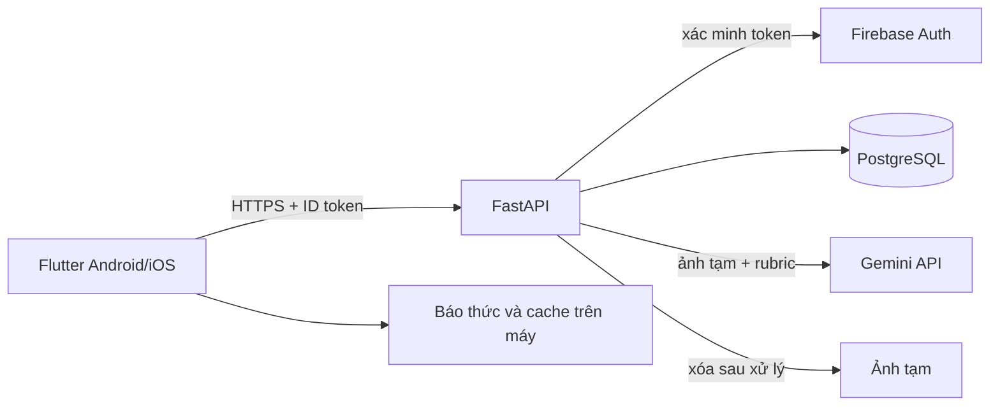

# Backend SQL — thiết kế khởi đầu

**Quyết định kiến trúc ngày 11/11/2026:** FastAPI tiếp tục là API; **PostgreSQL là nguồn dữ liệu có thẩm quyền** cho phiên, câu hỏi, XP và thi đấu. SQLite chỉ dùng cho demo/local một máy; không dùng SQLite làm server nhiều người thi trực tuyến. Firebase Authentication dùng cho tài khoản online, backend xác minh ID token rồi ánh xạ `uid` sang `users.auth_subject`; khách local không có tài khoản server. Không dùng Firestore cho dữ liệu nghiệp vụ. Đây là thiết kế, **chưa có backend SQL đang chạy**. [Docs/06](06-kien-truc-va-du-lieu.md) nay đã mô tả kiến trúc SQL; hợp đồng HTTP ở [docs/07](07-hop-dong-api-va-ai.md) là nguồn chuẩn giao tiếp.

**Mở rộng sản phẩm:** [docs/32](32-ho-so-hoc-tap-va-nhieu-mon.md) thêm bảng hồ sơ nhiều môn, mục tiêu thi, task/nhắc lịch và gợi ý giờ dậy; [docs/31](31-bao-thuc-thu-thach.md) thêm mode không Hoãn và số lần sai rõ; [docs/39](39-bai-lam-co-trinh-bay-va-cham-cong-bang.md) thêm grading decisions/reviews; [docs/40](40-dau-truong-pvp-nhan-vat-ban-do-va-hieu-ung.md) thêm status/FX trận. Cần đưa các bảng/cột này vào migration khi code, không lưu dưới dạng JSON tùy tiện trong `users`.

## 1. Vì sao SQL

MindClock có nhiều quan hệ và bất biến: một người có lịch/báo thức/phiên; một phiên có lượt nộp; một sự kiện chỉ cấp XP một lần; hai bên trận đấu cùng chốt kết quả. SQL cho khóa ngoại, unique constraint và transaction rõ. PostgreSQL hỗ trợ [ràng buộc unique](https://www.postgresql.org/docs/current/ddl-constraints.html); dùng transaction để ghi phiên, XP và kết quả nhất quán. Không chuyển sang SQL vì giao diện cần React; lựa chọn giao diện và CSDL độc lập.

## 2. Sơ đồ thành phần



Ở demo 0 đồng có thể thay Firebase Auth bằng **tài khoản demo giả lập chỉ trong môi trường local**, AI bằng fixture, DB bằng SQLite local. Không được nối chế độ demo vào production. Online hai máy cần API và DB cùng truy cập qua mạng; nếu chưa có chỗ host miễn phí đáng tin, trình diễn giao hữu bằng dữ liệu mẫu có nhãn.

## 3. Cấu trúc backend dự kiến

```text
services/api/
  app/main.py
  app/config.py
  app/auth/verify_token.py
  app/db/base.py
  app/db/models/
  app/repositories/
  app/services/alarm.py
  app/services/grading.py
  app/services/xp.py
  app/services/competition.py
  app/routes/v1/
  alembic/versions/
  tests/
```

SQLAlchemy 2.x cho model/query và Alembic cho migration là lựa chọn đề xuất; [SQLAlchemy](https://docs.sqlalchemy.org/en/20/orm/session_transaction.html) dùng transaction context và [Alembic](https://alembic.sqlalchemy.org/en/latest/tutorial.html) quản lý schema revision. Pin phiên bản khi bắt đầu code. Một DB session/request, không chia sẻ session giữa request/task; chỉ commit ở service transaction boundary. Không giữ transaction mở lúc chờ Gemini: tạo attempt `pending` → gọi AI ngoài transaction → chốt kết quả trong transaction ngắn.

## 4. Bảng dữ liệu MVP

| Bảng | Cột chính | Ràng buộc/index quan trọng |
| --- | --- | --- |
| `users` | `id UUID PK`, `auth_subject`, `alias`, `grade_band`, `locale`, `time_zone`, `consent_version`, timestamps | `auth_subject UNIQUE`; không dùng email làm PK |
| `alarms` | `id`, `user_id`, `local_time`, `time_zone`, `weekdays_mask`, `enabled`, `snooze_minutes`, `revision` | FK user; `revision >= 1`; chỉ cấu hình, chuông chạy local |
| `timetable_slots` | `id`, `user_id`, `weekday`, `subject_code`, `topic_id`, `position` | FK user; `weekday 1..7`; unique user/day/position |
| `questions` | `id`, `subject_code`, `grade_band`, `topic_id`, `difficulty`, `prompt`, `answer_spec_json`, `reasoning_prompt_vi`, `rubric_json`, `rubric_revision`, `status`, `revision`, `approved_by` | Index `(status, grade_band, subject_code, topic_id, difficulty)`; published cho chấm phải có rubric trình bày/người duyệt |
| `alarm_sessions` | `id`, `user_id`, `alarm_id`, `local_session_id`, `question_id`, `question_revision`, `local_date`, `time_zone`, `state`, `version`, timestamps | `UNIQUE(user_id, local_session_id)`; FK; version chống ghi đè |
| `attempts` | `id`, `session_id`, `client_attempt_id`, `kind`, `grade_status`, `feedback_json`, `rubric_revision`, `model_version`, `created_at` | `UNIQUE(session_id, client_attempt_id)`; **không lưu ảnh** |
| `xp_ledger` | `id`, `user_id`, `source_type`, `source_id`, `reason`, `delta`, `created_at` | `UNIQUE(user_id, source_type, source_id, reason)`; delta theo rule server |
| `topic_progress` | `user_id`, `topic_id`, `attempts`, `correct`, `next_review_at`, `updated_at` | PK `(user_id, topic_id)`; chỉ server cập nhật |
| `idempotency_records` | `user_id`, `key`, `route`, `payload_hash`, `response_json`, `expires_at` | `UNIQUE(user_id, key)`; cùng key khác payload = 409 |
| `consent_events` | `id`, `user_id`, `scope`, `version`, `granted`, `occurred_at` | Append-only; hiện trạng tính từ event mới nhất |

Kiểu `UUID`, `JSON/JSONB`, timestamp timezone-aware; ứng dụng ghi UTC, `local_date` giữ ngày tại múi giờ người học. Với SQLite local, dùng kiểu tương thích qua ORM và test transaction chính trên PostgreSQL trước pilot. Không cho mobile truy cập SQL trực tiếp. Từng bảng có chính sách xóa/ẩn theo [docs/25](25-bao-mat-va-du-lieu.md).

## 5. Giao hữu và bảng hạng sau MVP

| Bảng | Khóa và ý nghĩa |
| --- | --- |
| `competition_profiles` | PK `user_id`, opt-in, alias công khai, avatar allowlist |
| `matches` | PK `id`, scope nội dung, mode, state, combat/grading rule version |
| `match_players`, `match_rounds` | PK `(match_id,user_id)` và `(match_id,round_no)`; HP, bộ ba câu/revision, mốc giờ server |
| `round_skills`, `round_submissions`, `round_results` | Unique `(match_id,round_no,user_id)` cho lựa chọn/nộp, `(match_id,round_no)` cho kết quả |
| `match_results`, `match_events` | Một kết quả/trận; event sequence bất biến để reconnect |
| `rank_ledger` | Một dòng settle/người/trận/scope/mùa; correction là dòng bù trừ riêng có `review_id` unique; hai phía settle cùng transaction theo docs/44 |
| `score_ledger` | unique `(board_id,user_id,source_id)`, điểm học tuần do server tính |
| `leaderboard_entries` | PK `(board_id,user_id)`, score, alias snapshot, updated_at; index `(board_id,score DESC,user_id)` |

`boards` định nghĩa môn/khối/tuần; `groups` và `group_memberships` thêm khi mở thi nhóm. Trận `uncertain/voided` không ghi RP/MMR. Bảng top 20 query theo index và keyset cursor, không quét toàn bộ attempts. Luật Solo RPG ba vòng và schema chi tiết ở [docs/35](35-solo-rpg-dong-bo-va-ky-nang.md); ví/coin/RP ở [docs/37](37-kinh-te-rank-va-nhan-vat-2d.md); bài giải/quyết định chấm ở [docs/39](39-bai-lam-co-trinh-bay-va-cham-cong-bang.md); status/HP/FX ở [docs/40](40-dau-truong-pvp-nhan-vat-ban-do-va-hieu-ung.md); revision câu ở [docs/34](34-ngan-hang-cau-hoi-da-mon.md); staging/provenance ở [docs/38](38-nguon-du-lieu-va-duong-nhap-cau-hoi.md). Không tạo bảng `match_submissions` kiểu một dòng/người/trận của thiết kế cũ.

## 6. Transaction bắt buộc

1. **Tạo phiên:** insert `alarm_sessions` với unique `(user_id,local_session_id)`; retry trả phiên cũ. Kiểm tra question revision và ownership.
2. **Nộp bài:** unique `client_attempt_id`; kiểm tra trạng thái và giới hạn lượt. AI chạy ngoài transaction. Chốt `grade_status`, state phiên và `xp_ledger` trong cùng transaction ngắn; unique ledger chống cấp hai lần.
3. **Sửa kết quả AI:** thêm bản ghi audit; đảo/điều chỉnh XP bằng ledger mới, không xóa lịch sử cũ. Không cho AI trực tiếp ghi SQL.
4. **Trận:** lock hàng match và hai player theo thứ tự ổn định, xác nhận hai submission/vòng, chốt outcome và hai dòng RP/MMR ledger cùng XP/coin ledger trong một transaction; retry không đổi điểm. Tránh lock lâu khi chờ mạng. Quy tắc ví/cửa hàng có transaction riêng ở docs/37.
5. **Xóa tài khoản:** ẩn leaderboard/thu hồi quyền ngay; xóa dữ liệu cá nhân theo batch và chứng thực trạng thái; không báo hoàn tất trước khi xong.

## 7. API, bảo mật và vận hành

- API `/v1` theo [docs/07](07-hop-dong-api-va-ai.md); backend xác minh Firebase ID token, tự lấy UID và tra `users`. Không nhận điểm, role hoặc `user_id` từ client làm sự thật.
- SQL dùng query tham số hóa/ORM; DB credential chỉ server giữ, quyền DB chia migration/runtime và tối thiểu. Không log SQL params có PII, ảnh, token hoặc lời giải.
- Migration Alembic có upgrade và kế hoạch rollback; test migrate DB trống và DB có dữ liệu mẫu. Không dùng `create_all()` thay migration trên staging/production.
- Backup/restore PostgreSQL, kiểm thử khôi phục, và quy trình xóa dữ liệu phải đi cùng nhau. `health` kiểm tra API; readiness kiểm tra DB nhưng không lộ DSN.
- Local 0 đồng: Python + SQLite + Gemini mock. Test CI có thể dùng PostgreSQL chạy local/container nếu đội cài được; SQLite không thay kiểm thử khóa/transaction PostgreSQL cho XP và rating.

## 8. Chuyển từ docs Firestore cũ

| Tài liệu cũ | Tình trạng khi coding SQL |
| --- | --- |
| `docs/06` | Đã viết lại kiến trúc SQL và local-first; dùng trực tiếp khi code. |
| `docs/17` | Đã viết lại workflow với PostgreSQL, guest local và bài offline không chấm. |
| `docs/18` | Đã viết lại hướng dẫn API/SQL/Gemini; không tạo Firestore adapter. |
| `docs/21` bảng đấu trường | Đã viết lại ranh giới xã hội/bảng; luật trận ở docs/35–40, SQL ở docs/28. |
| `docs/12`, `docs/25` | Kiểm thử quyền API/DB, migration, backup và SQL retention; Firebase Auth vẫn cần cấu hình an toàn. |

**Cổng bắt đầu code:** quyết định ADR-002 ở đầu trang đã chốt PostgreSQL về mặt thiết kế; task triển khai ghi version/hosting/ngân sách, migration đầu và test unique/transaction. Vì repo hiện chưa có dữ liệu production, chưa cần chuyển dữ liệu thật. Không tuyên bố SQL đã được triển khai chỉ vì có tài liệu này.

