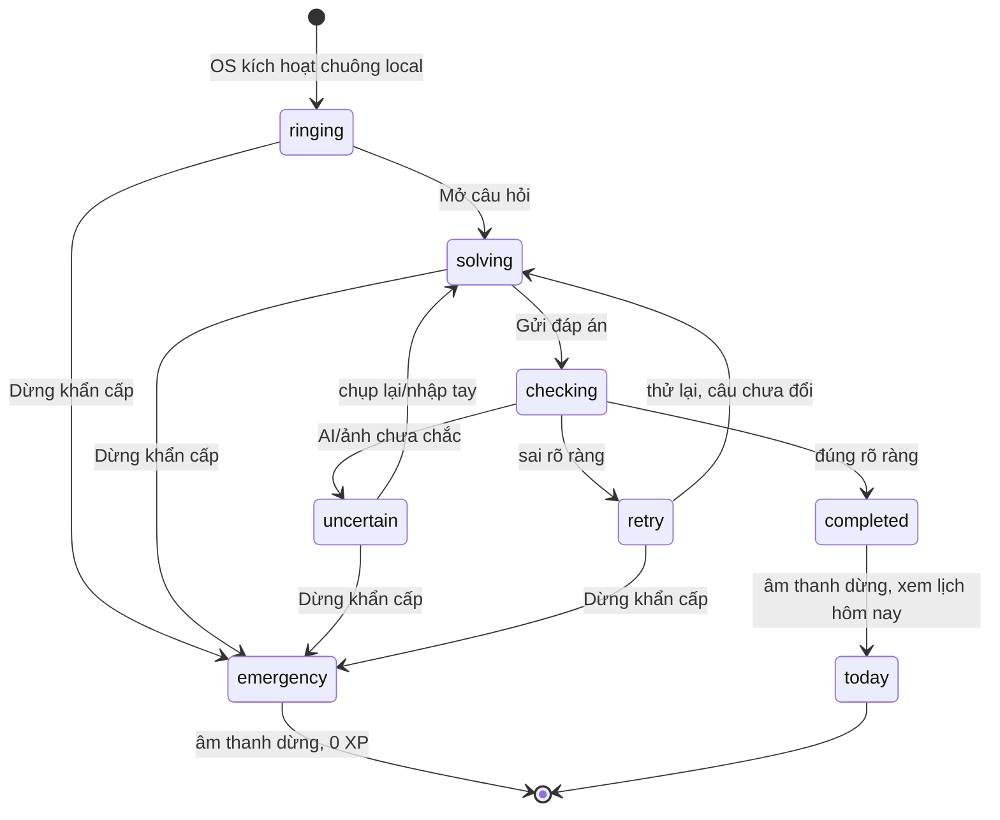

# Báo thức thử thách — luồng khó bỏ qua

**Trạng thái:** đặc tả sản phẩm để coding và thử nghiệm Android; chưa có báo thức thật. Đây là chế độ người dùng **tự bật** sau khi xem rõ cách hoạt động. Chế độ này thay quy tắc Hoãn/gợi ý sớm của docs cũ; xem [PRD](04-prd-va-dac-ta-san-pham.md) và [UX](05-ux-va-noi-dung-tieng-viet.md). Hệ điều hành và người dùng vẫn kiểm soát điện thoại; không hứa “không thể tắt” hoặc “chống gian lận tuyệt đối”.

## 1. Mục tiêu và giới hạn

- Mục tiêu: người học phải thực hiện một hành động tư duy ngắn trước khi quay lại ngủ; không biến bài sáng thành bài kiểm tra áp lực.
- Chế độ thử thách **không có Hoãn** trong UI app. `Dừng khẩn cấp` luôn có; một lần chạm dừng âm/rung local ngay cả khi offline/AI lỗi. Có thể hỏi xác nhận/lý do tùy chọn **sau khi đã dừng**, không phát lại chuông nếu người dùng bỏ qua. Không trừ XP/rank, không công khai lý do.
- Không khóa nút nguồn, điều khiển âm lượng, Home, khóa màn hình, gỡ app hay hành động hệ thống. Android full-screen intent phụ thuộc quyền/thiết bị; trên iOS AlarmKit có nút Dừng của hệ thống.
- Âm lượng và âm báo do người dùng chọn trong mức OS cho phép. Không tự tăng về mức tối đa hoặc cố phát qua chế độ người dùng đã tắt quyền.

## 2. Thiết lập trước đêm đầu tiên

1. Chọn giờ/ngày lặp, âm báo, rung, mức khó `Dễ / Vừa`, thời lượng mục tiêu 60–90 giây. Có thể xem **gợi ý giờ dậy** từ lịch/đường đi theo [docs/32 §5](32-ho-so-hoc-tap-va-nhieu-mon.md#5-gợi-ý-giờ-dậy-khi-đặt-báo-thức); người dùng xác nhận, app không tự đổi giờ.
2. Chọn `Báo thức thử thách`; UI nói rõ: `Không có nút Hoãn. Bạn sẽ làm một câu ngắn để hoàn thành. Dừng khẩn cấp luôn có.`
3. Chọn môn từ [hồ sơ học tập](32-ho-so-hoc-tap-va-nhieu-mon.md), hoặc `Theo lịch học ngày mai`; app hiển thị ví dụ câu.
4. Kiểm tra quyền báo thức hệ thống, đặt lịch local và tải sẵn ít nhất 1 câu đã duyệt + 1 câu dự phòng phù hợp. Nếu thiếu quyền/câu dự phòng, không hiển thị `Đã sẵn sàng`.
5. Cho thử chuông 10 giây để người dùng hiểu nút Dừng và âm lượng; không tự bật chế độ khó khi họ chưa xác nhận.

## 3. Luồng buổi sáng

Khi mở câu hỏi, có thể **giảm âm lượng** để đọc/làm bài, nhưng không tắt hẳn trước khi hoàn thành hoặc dừng khẩn cấp. Cần thử với người dùng vì âm thanh liên tục có thể khiến họ nộp vội. Một phiên chỉ có một câu chính; không đổi câu mỗi lần sai để tránh thử đến khi gặp câu dễ hơn.

## 4. Sai nhiều lần và gợi ý

| Tình huống | Phản hồi | Gợi ý/đáp án |
| --- | --- | --- |
| Sai rõ lần 1–2 | `Bài này chưa đúng. Bạn có thể thử lại.` | Không lộ bước sai, gợi ý hoặc đáp án |
| Sai rõ lần 3 | Một câu hướng dẫn **phương pháp**; ví dụ `Thử phân tích thành nhân tử.` | Không cho kết quả cuối |
| Sai rõ lần 4–5 | Gợi ý cụ thể hơn hoặc **câu tương đương dễ hơn** theo rubric đã duyệt | Không lặp vô hạn; người dùng vẫn có Dừng khẩn cấp |
| `uncertain`, ảnh mờ, AI timeout | `Chưa đủ rõ để chấm. Chụp lại hoặc nhập đáp án.` | **Không tăng bộ đếm sai**; không trừng phạt |
| Không có mạng | Đề đã cache hoặc câu dự phòng local; người học có thể viết bài và `Hoàn thành không chấm` hoặc Dừng khẩn cấp | Không gửi đáp án/rubric trong cache API; không tự tuyên bố bài tự do là `correct` |

Không có gợi ý trước khi nộp sai trong chế độ thử thách. Bộ đếm sai là **số lần `incorrect` đã xác nhận**, không phải số lần chụp/timeout. Sau 5 lần, app không tiếp tục tăng âm lượng/độ khó; người dùng có thể thử câu tương đương ngắn hoặc dừng khẩn cấp. Khi dừng, có thể xem lời giải sau khi chuông đã tắt, không dùng lời giải để “qua cửa”.

## 5. Chống làm vẹt và dùng AI giải hộ

- Câu lấy từ ngân hàng được duyệt, có nhiều biến thể cùng kỹ năng; chọn theo môn/chủ đề và tránh lặp câu gần đây. Không sinh câu chưa kiểm chứng lúc chuông reo.
- Với mọi môn có chấm, yêu cầu **một lý do/bước giải ngắn do người học viết** bằng ô chữ hoặc ảnh nháp; câu trắc nghiệm chỉ khoanh đáp án không đủ để nhận `correct`. Rubric do người dạy duyệt theo [docs/39](39-bai-lam-co-trinh-bay-va-cham-cong-bang.md). Nếu offline/bộ chấm lỗi, cho `Hoàn thành không chấm` hoặc Dừng khẩn cấp; bản nháp chữ chỉ gửi sau khi người học chọn theo [hợp đồng offline](07-hop-dong-api-va-ai.md#8-quy-tắc-offline-khách-local-và-đồng-bộ-bài). Không giả vờ đọc/chấm bài tự do bằng local validator.
- Android có thể dùng `FLAG_SECURE` trên màn đề để hạn chế chụp màn hình/chiếu màn; phải thử thiết bị và báo rõ giới hạn. Không thể ngăn điện thoại khác chụp đề hoặc người dùng dùng AI ngoài app.
- Không yêu cầu camera chụp khuôn mặt, không theo dõi app khác, không đọc clipboard hay tự kết luận gian lận. Mục tiêu là tăng khả năng tự làm, không đạt bảo đảm chống gian lận.
- Ghi phương thức trả lời (`text`, `photo`, `choice`), độ tin cậy và `rubricRevision`; chỉ cấp XP khi kết quả rõ, server kiểm tra idempotency. AI không tự cấp điểm.

## 6. Nội dung UI ngắn

| Màn | Nội dung |
| --- | --- |
| Thiết lập | `Báo thức thử thách` · `Không có Hoãn. Dừng khẩn cấp luôn có.` |
| Reo | `06:30` · `Một câu Sinh học` · `Mở câu hỏi` · `Dừng khẩn cấp` |
| Làm bài | `Chọn/nhập đáp án` · `Viết cách làm` (hoặc `Chụp nháp`) · `Gửi bài` · `Dừng khẩn cấp` |
| Sai 1–2 | `Chưa đúng. Thử lại.` |
| Sai 3 | `Gợi ý: hãy xét ...` · `Thử lại` |
| Chưa rõ | `Chưa đọc rõ bài. Chụp lại hoặc nhập đáp án.` |
| Hoàn thành | `Đã xong câu ôn. Hôm nay bạn có ...` |

## 7. Cổng kiểm thử trước khi gọi là báo thức thật

- Android thật: app background/đóng, màn khóa, quyền full-screen bị từ chối, không mạng, reboot, tiết kiệm pin, âm thanh đã chọn, Dừng khẩn cấp ở mọi trạng thái.
- Không có Hoãn trong chế độ thử thách; chế độ thường nếu giữ Hoãn phải phân biệt rõ trong cài đặt và test.
- Sai rõ 1–2 không có hint; sai lần 3 có hint phương pháp; `uncertain` không tăng lượt sai; quá 5 lần không vòng lặp vô hạn.
- Mỗi môn được bật phải có câu offline dự phòng và evaluator phù hợp; không dùng một rubric Toán cho mọi môn.
- Chụp màn hình không lộ đề trên thiết bị hỗ trợ; máy khác vẫn có thể chụp nên không tuyên bố chặn hoàn toàn.

