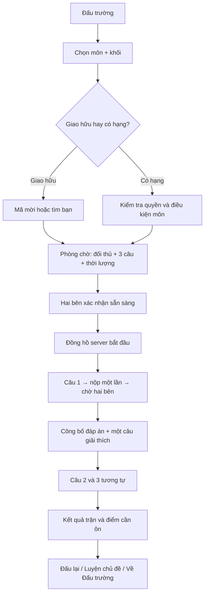

# Đấu trường Solo 1v1 và bảng hạng — thiết kế sản phẩm

> **Lưu trữ bản v1 (10/11/2026).** Luật ba câu tính điểm, không máu/kỹ năng trong tài liệu này đã được thay bởi [Solo RPG v2](35-solo-rpg-dong-bo-va-ky-nang.md). Không dùng bản v1 để coding luật trận. Các nguyên tắc opt-in, quyền riêng tư và cổng mở rank vẫn tham khảo được nếu không mâu thuẫn với v2.

**Trạng thái:** đặc tả để lập task coding; chưa có trận online/rating chạy thật. Tài liệu này cụ thể hóa [luật đấu trường v1](21-dau-truong-xep-hang.md) và [hồ sơ nhiều môn](32-ho-so-hoc-tap-va-nhieu-mon.md). Nếu khác nhau, dùng tài liệu này cho **Solo 1v1**; [schema SQL](28-backend-sql.md) là nguồn chuẩn lưu trữ. Thi đấu độc lập với báo thức; không ép tham gia lúc mới thức.

## 1. Đề xuất một câu

`Chọn môn, làm cùng ba câu với một bạn cùng khối, xem kết quả và phần cần ôn.` Đây là trải nghiệm trọng tâm. Cảm giác cuốn đến từ đối thủ thật, câu công bằng, kết quả rõ sau từng vòng, tiến bộ cá nhân và khả năng đấu lại; không cần hiệu ứng dày hoặc phạt mạnh.

## 2. Các chế độ và thứ tự mở

| Chế độ | Đối thủ | Kết quả | Mở khi |
| --- | --- | --- | --- |
| Luyện solo | Không | Phản hồi riêng, không rating | Có ngân hàng câu duyệt |
| Giao hữu bằng mã | Bạn được mời, cùng khối/môn | Trận 3 câu, không rating | Hai tài khoản, API và đồng bộ trận ổn |
| Ghép giao hữu | Người lạ cùng môn/khối | Không rating, biệt danh | Đủ người và kiểm tra quyền riêng tư |
| Solo có hạng | Ghép theo môn/khối/rating | Rating riêng từng môn + bảng mùa | Qua cổng chất lượng §13 |

**Không dùng bot giả làm người thật.** Khi hàng chờ ít người, cho luyện solo hoặc mã mời giao hữu; không tạo trận có hạng với bot. Mỗi môn bật hạng riêng, không tự mở tất cả môn chỉ vì app có câu hỏi.

## 3. Điều kiện bật đấu trường

Người dùng vào `Đấu trường → Bật tham gia`, xem: biệt danh/avatar hiển thị, môn/khối ghép, cách tính kết quả, quyền rời bảng; xác nhận riêng. Email đã xác minh và quy trình đồng ý theo độ tuổi phải xong trước bảng công khai. Cho đổi biệt danh/avatar trong whitelist, bật/tắt từng môn, rời bảng ngay. Không dùng tên thật, ảnh cá nhân, giờ dậy, trường/lớp cụ thể, hoặc thời khóa biểu trên bảng. Có `Chặn/Báo cáo` cho người lạm dụng mã mời; chưa có chat tự do.

## 4. Luồng người chơi



**Màn bắt buộc:** sảnh đấu → chọn môn/chế độ → tìm trận → phòng chờ → câu hỏi → chờ đối thủ → kết quả vòng → kết quả trận → bảng hạng → hồ sơ avatar/riêng tư → trạng thái lỗi/mất mạng. Vào trận tối đa 3 thao tác sau khi đã chọn môn lần đầu. Trong trận không hiện bảng hạng, không có quảng cáo, chat, pet animation lặp hoặc hiệu ứng che đề.

### Chi tiết một trận

- **Ba vòng**, mỗi vòng một câu đã duyệt, mục tiêu 60–90 giây; tổng trận dự kiến 4–6 phút gồm chuyển vòng. Hai người thấy **cùng câu và cùng mốc bắt đầu/kết thúc theo server**. Bộ ba câu được khóa tại lúc tạo match, không đổi theo từng người.
- Chỉ dạng có kết quả kiểm chứng rõ vào **ranked**: chọn đáp án, sắp thứ tự, ghép cặp, điền đáp án ngắn đã chuẩn hóa, tính số có tolerance. Bài ảnh viết tay hoặc câu mở dùng giao hữu/luyện trước khi bộ chấm đủ tin cậy; AI không là trọng tài duy nhất trong ranked.
- Mỗi người có **một lần nộp/vòng**, xem `Đã nhận bài` rồi chờ. Không lộ người kia chọn gì; chỉ hiện `Đối thủ đã nộp` khi sự kiện server xác nhận. Đáp án và giải thích công bố sau khi cả hai nộp hoặc hết hạn.
- Mỗi câu đúng = **1 điểm vòng**; sai/hết giờ = 0. Không thưởng tốc độ ở bản đầu vì độ trễ mạng/thiết bị khác nhau. Nếu cùng điểm sau ba vòng, kết quả **hòa**. Không ép tiebreak vô hạn.
- Sau trận có `Bạn đúng 2/3 câu`, `Chủ đề cần ôn: ...`, nút `Luyện chủ đề` và `Đấu lại`. Đấu lại với cùng đối thủ chỉ là giao hữu hoặc bị giới hạn số trận tính hạng/ngày để tránh farm.

## 5. Ghép trận và công bằng

1. Bộ lọc bắt buộc: `mode`, `subject`, `gradeBand`, `questionPoolVersion`, `region` chỉ để tối ưu độ trễ nếu không gây lộ vị trí. Không ghép khác môn/khối khi có hạng.
2. Rating band ban đầu ±100; sau 15 giây mở ±200; sau 30 giây báo `Chưa tìm thấy bạn cùng môn`, cho tiếp tục chờ hoặc chuyển giao hữu/luyện. Các số là tham số thử nghiệm, không cam kết.
3. Một tài khoản chỉ một queue ticket và một match active; queue có TTL, hủy idempotent. Hai người bấm sẵn sàng; nếu một người bỏ trước câu đầu, hủy **không đổi rating**.
4. Server chốt thời gian và idempotency. Nếu mất kết nối trước khi câu hiển thị đủ, void. Mất mạng trong vòng: giữ hạn server, cho gửi lại cùng attempt key trước hạn; không tự động coi vắng mạng là thua nếu không có bằng chứng hiển thị. Lỗi server/đề → void và hoàn tác thay đổi rating bằng ledger có audit.
5. Không gán nhãn gian lận chỉ từ tốc độ/lựa chọn. Cùng thiết bị, nhiều tài khoản hoặc cặp đối thủ lặp bất thường được đưa vào rà soát nội bộ; không công khai cờ nghi ngờ.

## 6. Điểm, XP, rating và hạng

| Chỉ số | Công thức/nguồn | Hiện ở đâu | Có giảm khi thua? |
| --- | --- | --- | --- |
| Điểm vòng | 0 hoặc 1/câu, tối đa 3/trận | Màn trận/kết quả | Không lưu như XP |
| XP học tập | +5 khi hoàn tất ≥2 vòng hợp lệ; +2 mỗi câu đúng, tối đa 11 XP/trận có hạng; tối đa 3 trận tính XP/ngày | Hồ sơ học tập | Không |
| Rating môn | ELO theo kết quả thắng/hòa/thua **toàn trận**, tính server | Hồ sơ đấu trường/bảng mùa | Có thể giảm sau thua hợp lệ |
| Hạng học tập | Mốc XP cá nhân, cosmetic | Hồ sơ chung | Không |
| Huy hiệu mùa | Dựa mốc rating và đủ trận trong mùa | Hồ sơ đấu trường/avatar | Hết mùa lưu huy hiệu lịch sử |

XP là phần thưởng **tham gia và học**, không phải tiền hay lợi thế câu hỏi. Kể cả thua vẫn có XP hợp lệ; không cấp XP cho trận void hoặc chưa đủ 2 vòng, để hạn chế tạo match rồi rời. Cấp XP và rating qua ledger có khóa unique; client không gửi giá trị điểm. Số cộng là đề xuất cần playtest và kiểm tra farm.

**Rating:** dùng ELO như [docs/21](21-dau-truong-xep-hang.md), khởi tạo 1000, K=24 trong mùa thử, `S=1/0.5/0`. Hai người phải thuộc cùng scope `{subject,gradeBand,seasonId}`. Trận `uncertain/needs_review/voided` không đổi rating. Bắt đầu 5 trận `đang xếp hạng` không hiện vị trí công khai để tránh cảm giác thứ hạng giả từ mẫu nhỏ; rating vẫn được tính sau trận hợp lệ. Không dùng rating môn Toán để ghép môn Anh hoặc chọn độ khó câu báo thức.

**Khung hạng đấu trường đề xuất:** Đồng `<900`, Bạc `900–1099`, Vàng `1100–1299`, Bạch Kim `1300–1499`, Kim Cương `≥1500`, chỉ khi đủ 5 trận trong mùa. Ngưỡng là giả thuyết để mô phỏng, cần hiệu chuẩn phân phối rating và quy mô người chơi trước phát hành. Hiển thị nhãn chữ cùng hình khung theo [docs/27](27-quy-chuan-giao-dien-va-figma.md), không chỉ màu. Để tránh nhầm với hạng XP, UI ghi đầy đủ `Hạng đấu trường Toán 9` và `Hạng học tập` ở hai khu riêng.

## 7. Bảng xếp hạng

| Bảng | Phạm vi | Thứ tự | Khi nào hiện |
| --- | --- | --- | --- |
| Solo mùa | Môn + khối + mùa 4 tuần | Rating giảm dần; cùng rating cùng hạng | ≥10 người opt-in và mỗi người đủ 5 trận mới có tên |
| Bạn bè | Người dùng tự tạo quan hệ và đồng ý | Rating cùng môn/khối, chỉ người đủ điều kiện | Giai đoạn sau, không lấy danh bạ |
| Nhóm/lớp | Điểm trung bình có trần/người/ngày | Theo [docs/21](21-dau-truong-xep-hang.md) | Sau khi có consent nhóm |

Màn bảng có lọc `Môn`, `Khối`, `Mùa`; Top 20 + vị trí của tôi, ngày cập nhật, nút `Cách tính hạng` và `Ẩn tôi khỏi bảng`. Nếu chưa đủ người: `Chưa đủ người để mở bảng môn này.` Nếu người dùng chưa đủ 5 trận: chỉ thấy rating riêng và `Còn N trận để hiện trên bảng`. Không dùng thông báo tụt hạng, so sánh trường/lớp, hoặc nêu giờ chơi. Rời bảng ẩn biệt danh/avatar khỏi API và cache hiển thị ngay; quyền xóa dữ liệu theo [docs/25](25-bao-mat-va-du-lieu.md).

## 8. Avatar, khung và động lực

- Thiết kế avatar cũ đã hủy; xem [trạng thái roster](22-nhan-vat-rpg.md). Bản prototype dùng avatar trung tính 48 px, không gắn sức mạnh hay lợi thế thi với nhân vật.
- Khung avatar hạng đấu trường có hình theo bậc, chuyển động **một lần** khi đạt mốc; người dùng bật giảm chuyển động sẽ thấy khung tĩnh. Không có hiệu ứng đánh bại thú đối thủ.
- Phần thưởng sau trận: một nhận xét học tập + XP rõ nguồn; sau 3 trận hợp lệ trong tuần, mở phụ kiện mỹ thuật nhỏ (đề xuất, không gacha). Khi thua: `Bạn đúng 1/3 câu. Xem lại câu 2.` Không dùng câu “thất bại” hay ép đấu tiếp.
- Chặn lời mời, im lặng thông báo thi đấu, nghỉ mùa không mất XP/nhân vật. Không yêu cầu chơi vào sáng sớm để giữ streak.

### Màn chọn avatar và khung

`Tôi → Nhân vật` cho xem ba mẫu 3D render tĩnh cùng tên; bấm một mẫu → xem 3/4 và avatar 48 px → `Chọn nhân vật`. `Tôi → Khung hạng` cho xem khung hiện tại và mốc tiếp theo; khung theo rating chỉ xuất hiện nếu đã bật Solo có hạng và đủ 5 trận. Người chưa bật thi đấu vẫn chọn nhân vật/khung học tập bình thường. Không cần tạo nhân vật từ ảnh người dùng, không gacha hoặc trả phí. Biệt danh có thể sửa riêng; đổi nhân vật không đổi rating và không gửi thông báo cho đối thủ.

### Wireframe nội dung tối thiểu

```text
SẢNH: Đấu trường             PHÒNG CHỜ: Toán 9
Toán 9 · Giao hữu / Có hạng   Người chơi A  vs  Người chơi B
Tìm trận  [nút chính]        3 câu · khoảng 5 phút
Mã mời bạn                   Sẵn sàng [nút chính]
Bảng mùa / Cách tính hạng     Hủy tìm trận

VÒNG 2/3                     KẾT QUẢ
Đề + lựa chọn/ô đáp án       Bạn đúng 2/3 câu
Còn 01:12                    Kết quả: Hòa · rating +0
Gửi đáp án [nút chính]       Câu cần ôn: ...
Đối thủ đã nộp (nếu có)      Luyện chủ đề / Đấu lại
```

Không dùng avatar hoạt họa trên màn câu. Trạng thái đối thủ chỉ là chữ/icon tĩnh, không truyền lựa chọn của họ trước reveal. Sau vòng có 2–3 giây đọc đáp án, người dùng bấm `Tiếp tục` hoặc server tự sang vòng khi cả hai sẵn sàng; nếu một người chậm, giới hạn chờ có thông báo rõ.

## 9. Trạng thái lỗi và bản demo

| Trạng thái | UI | Quyết định backend |
| --- | --- | --- |
| Không có đối thủ | `Chưa tìm thấy bạn cùng môn. Luyện một mình hoặc thử lại.` | Hủy queue không phạt |
| Đối thủ rời trước câu 1 | `Trận chưa bắt đầu. Bạn có thể tìm trận mới.` | `cancelled`, 0 rating |
| Mất mạng sau câu 1 | `Đang kết nối lại. Bài đã nộp vẫn được giữ.` | Reconnect theo match state/attempt key |
| Hai bên cùng đúng/sai | `Vòng này hòa.` | Điểm vòng bằng nhau |
| Chấm chưa chắc/lỗi câu | `Trận này chưa tính hạng. Xem cách giải.` | `voided`/`needs_review`, 0 rating |
| Thiếu consent/tuổi | `Bạn có thể chơi giao hữu riêng. Bảng công khai chưa bật.` | Chặn ranked/board |

**Demo DevFest nếu chưa có online thật:** hai thiết bị hoặc hai cửa sổ dùng dữ liệu mẫu phải gắn `Mô phỏng trận đấu`. Không gọi scoreboard mock là realtime. Nếu làm demo thật, ưu tiên một môn/khối với ba câu cấu trúc đã duyệt và hai tài khoản thử; backend SQL chốt một trận. Chưa cần ELO công khai trong buổi thi.

## 10. KPI và thử nghiệm sản phẩm

Đo tự nguyện: tỷ lệ vào trận → hoàn thành, thời gian chờ, tỷ lệ void/mất mạng, tỷ lệ xem cách giải, tỷ lệ chọn luyện chủ đề sau trận, tỷ lệ tắt bảng, cảm giác áp lực tự báo. **Không dùng thời gian chơi hoặc số trận nhiều nhất** làm mục tiêu chính. Playtest với nhóm nhỏ theo từng môn/khối; hỏi người thua có muốn chơi lại vì học được gì, và người thắng có thấy câu công bằng không. Điều chỉnh ba câu/90 giây/K/rating band theo dữ liệu, không coi số trong docs là đã tối ưu.

## 11. Hợp đồng kỹ thuật tối thiểu

FastAPI/SQL theo [docs/28](28-backend-sql.md), API cơ bản ở [docs/21](21-dau-truong-xep-hang.md). Cần thêm `GET /v1/competition/subjects` trả môn/khối/chế độ đang mở; `POST /v1/matches/{id}/ready`; `GET /v1/matches/{id}/rounds/{roundNo}`; `POST /v1/matches/{id}/rounds/{roundNo}/submission`; `GET /v1/matches/{id}/events?cursor=...` (polling v1) hoặc WebSocket khi có lý do. Mọi write có token, idempotency và kiểm tra participant; sự kiện cho người chơi chỉ chứa trạng thái công khai, không chứa đáp án người kia trước reveal. Server ghi `question_set_version`, `scoring_rule_version`, `rating_rule_version` và mốc thời gian UTC.

SQL bổ sung `match_rounds(match_id,round_no,question_id,start_at,deadline_at,state)`, `round_submissions(match_id,round_no,user_id,answer_hash,grade_status,submitted_at,attempt_key)`, `match_results(match_id,winner_id nullable,outcome,score_a,score_b,settled_at,rule_version)`. Unique `(match_id,round_no,user_id)`, FK đầy đủ; rating ledger 2 dòng và result chốt cùng transaction. Bảng câu hỏi/điều kiện xuất bản tại [docs/34](34-ngan-hang-cau-hoi-da-mon.md).

## 12. Kế hoạch triển khai theo lát cắt

1. Một trận giao hữu local hai tài khoản, cùng 3 câu cấu trúc, polling kết quả; chưa rating/bảng.
2. Reconnect, deadline server, idempotency, void/error, quyền participant, test hai máy mạng yếu.
3. Opt-in/alias/avatar, bảng mùa riêng tư và ngưỡng tối thiểu.
4. Rating ledger và bảng công khai **sau cổng §13**; mở từng môn/khối.
5. Nhóm/bạn bè và mỹ thuật bổ sung sau pilot.

## 13. Cổng mở Solo có hạng

- Mỗi môn/khối có ngân hàng câu **đã duyệt và hiệu chuẩn** đủ để tạo bộ 3 câu không lặp thường xuyên; câu có đáp án kiểm chứng tự động và revision bất biến.
- 100% trận test không ghi rating hai lần khi retry; hai rating ledger chốt cùng result; void không đổi rating.
- Hai máy thật mạng lệch vẫn thấy cùng câu/deadline và kết quả; lỗi reconnect có đường phục hồi.
- Có opt-in/opt-out, alias, chặn/báo cáo, xử lý người chưa thành niên và khiếu nại theo chính sách.
- Có người phụ trách nội dung và vận hành. Nếu thiếu bất kỳ cổng nào, giữ **giao hữu không tính hạng**.

## 14. Acceptance và kiểm thử để giao coding

| ID | Tình huống | Kết quả cần đạt |
| --- | --- | --- |
| R01 | Hai tài khoản cùng môn/khối tìm trận | Một match, cùng 3 question revision và deadline server |
| R02 | Một tài khoản tìm hai lần/nộp lặp cùng key | Một ticket/một submission/vòng, cùng response; key khác payload trả 409 |
| R03 | Cả hai đúng 2/3 câu | Hòa, rating delta theo công thức hòa; không dùng thời gian làm tie-break |
| R04 | Một người rời trước câu 1 | Hủy trận, không XP/rating |
| R05 | Mất mạng sau đã nộp câu 1 | Reconnect hiện đúng state, không nộp lại câu 1, câu 2 theo deadline |
| R06 | Câu lỗi hoặc AI `uncertain` | Void/needs_review, không đổi rating, cho xem lý do và cách giải khi an toàn |
| R07 | Hai worker cùng settle | Một result, đúng hai rating ledger, XP ledger không trùng |
| R08 | Người dùng opt-out/đổi alias | Board/API không còn alias cũ; trận lịch sử không lộ email/tên thật |
| R09 | Môn chưa đủ câu/khối ít người | Không có nút Có hạng; có luyện/giao hữu phù hợp |
| R10 | Cỡ chữ 200%, giảm chuyển động, máy yếu | Đề/nút nộp đọc được; không animation bắt buộc; avatar tĩnh |

Khi code một lát cắt, chuyển các dòng liên quan vào `tasks/TNNN-*/spec.md` và `tests.md`, chạy bằng hai phiên/tài khoản độc lập. Không coi bảng mock hoặc polling một máy là bằng chứng R01–R07.

