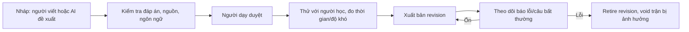

# Ngân hàng câu hỏi đa môn cho luyện tập và thi đấu

**Mục tiêu:** đội nội dung có thể soạn, duyệt, xuất bản và thu hồi câu hỏi; mobile/backend có thể chọn, chấm và giải thích nhất quán. Không dùng Gemini sinh câu mới ngay lúc ghép trận. Câu báo thức theo [docs/32](32-ho-so-hoc-tap-va-nhieu-mon.md), câu ranked theo [docs/33](33-dau-truong-solo-ranked-gdd.md). “Ngân hàng ngôn ngữ” ở đây gồm **văn bản tiếng Việt của câu, thuật ngữ môn, đáp án tương đương, gợi ý/giải thích và thông báo UI**, không chỉ một danh sách câu trắc nghiệm.

## 1. Cấu trúc một câu chuẩn

```json
{
  "questionId": "bio9-cell-001",
  "revision": 1,
  "locale": "vi-VN",
  "subjectCode": "biology",
  "gradeBand": "9",
  "topicId": "cell_structure",
  "learningOutcome": "Nhận biết chức năng của nhân tế bào",
  "difficultyBand": 1,
  "estimatedSeconds": 65,
  "modeEligibility": ["practice", "alarm", "ranked"],
  "answerType": "single_choice",
  "stem": "Bộ phận nào chứa phần lớn vật chất di truyền của tế bào nhân thực?",
  "choices": [
    {"id": "A", "text": "Nhân tế bào"},
    {"id": "B", "text": "Màng sinh chất"},
    {"id": "C", "text": "Ribosome"},
    {"id": "D", "text": "Ti thể"}
  ],
  "answerSpec": {"correctChoiceId": "A"},
  "explanation": "Nhân tế bào chứa phần lớn DNA của tế bào nhân thực.",
  "hintLevels": ["Xác định nơi chứa DNA trong tế bào nhân thực."],
  "sourceLicense": "team-authored",
  "status": "draft"
}
```

Ví dụ chỉ là mẫu schema, **chưa được người dạy duyệt để đưa vào sản phẩm**. Bản `published` cần `editorId`, `reviewerId`, `approvedAt`, `rubricRevision`, `contentHash`; sửa stem/đáp án tạo revision mới. Đề/ảnh/tư liệu nguồn chỉ dùng khi có quyền và dẫn nguồn trong metadata.

## 2. Loại câu theo môn và chế độ

| Môn | Dạng phù hợp giao hữu/ranked đầu | Dạng luyện tập/báo thức mở rộng | Điều kiện trước khi bật ranked |
| --- | --- | --- | --- |
| Toán | Số/biểu thức ngắn, chọn kết quả, chọn bước biến đổi đúng | Ảnh một bước giải | Validator số/tương đương, nhiều cách giải được duyệt |
| Vật lí/Hóa học | Giá trị + đơn vị, chọn định luật/công thức, nhận diện hiện tượng | Ảnh phép tính ngắn | Đơn vị/tolerance rõ, dữ kiện đủ |
| Tiếng Anh | Điền từ có accepted variants, ngữ pháp, đọc một câu rồi chọn ý | Viết câu ngắn, phát âm về sau | Không có hai đáp án đúng ngoài danh sách; không chấm accent ở ranked |
| Sinh học | Khái niệm, quy trình, ghép chức năng | Giải thích cơ chế ngắn | Thuật ngữ chính xác, không trộn chương trình lớp |
| Lịch sử/Địa lí | Mốc/sự kiện/nguyên nhân với nguồn rõ, đọc bảng/biểu đồ ngắn | Giải thích liên hệ | Nguồn kiểm chứng và phiên bản dữ liệu, tránh câu tranh cãi |
| Ngữ văn | Nhận diện đặc điểm ngữ liệu có một đáp án rõ | Đọc hiểu/diễn giải mở | Chỉ câu đóng đã người dạy kiểm tra; không chấm bài văn nhị phân |
| Tin học/Công nghệ/Kinh tế & pháp luật | Dự đoán output, chọn bước/quy tắc đơn giản | Tình huống ngắn có phản hồi | Mã chạy/chuẩn/kiến thức được đối chiếu theo năm áp dụng |

Không cần mở mọi môn ngay. Mỗi môn có trạng thái `not_available`, `practice_only`, `friendly_enabled`, `ranked_enabled` theo **chất lượng bộ câu**, không theo nhu cầu marketing. UI có thể hiện môn chưa sẵn sàng nhưng không cho xếp trận ranked.

## 3. Phân loại và cân bằng

- `subject → gradeBand → topic → learningOutcome → difficultyBand (1..4) → answerType` là taxonomy bắt buộc. `tags` tự do chỉ bổ trợ, không thay taxonomy.
- Một bộ 3 câu ranked dùng 1 câu nhận biết, 1 câu thông hiểu, 1 câu vận dụng ngắn; hai người nhận **cùng bộ theo cùng thứ tự**. Nếu môn không có ba câu tương đương đã duyệt, không mở ranked.
- Dùng câu đã qua thử với người học để ước lượng thời gian và tỷ lệ đúng. `difficultyBand` là nhận định ban đầu của người dạy, cần hiệu chuẩn; không đưa câu quá khó vào trận chỉ để tạo thắng thua.
- Giảm học vẹt bằng biến thể có cùng mục tiêu học nhưng số liệu/ngữ cảnh khác, tránh lặp `questionId` và `variantFamilyId` trong khoảng gần. Biến thể do AI đề xuất phải được duyệt trước publish.
- Với câu nhiều lựa chọn, phương án nhiễu phải phản ánh lỗi hiểu thường gặp, không chơi chữ vô lý. Tránh tiết lộ đáp án qua độ dài hoặc ngữ pháp.

## 4. Bộ ngôn ngữ và phản hồi

Mỗi câu lưu `stem`, `choices`, `explanation`, `hintLevels`, `feedbackByErrorCode` trong `vi-VN`; thuật ngữ có `canonicalTerm`, `acceptedSynonyms`, `forbiddenAmbiguities`. Mỗi subject có glossary nhỏ để người biên tập giữ cách gọi nhất quán, ví dụ cùng một khái niệm không đổi tên qua các câu. Không chèn “AI cho rằng...” vào lời giải; giải thích phải nêu kiến thức và lý do.

| Trạng thái | Mẫu ngắn |
| --- | --- |
| Đúng | `Đúng. Xem cách giải.` |
| Sai trong ranked | `Chưa đúng. Xem đáp án sau vòng.` |
| Hai người cùng đúng | `Hai bạn đều đúng câu này.` |
| Hết giờ | `Vòng đã kết thúc. Xem cách giải.` |
| Câu bị hủy | `Câu này có lỗi, trận không tính hạng.` |
| Gợi ý khi luyện | `Thử xét ...` — một bước, không đáp án cuối |

**Khác biệt báo thức và ranked:** báo thức thử thách chỉ cho gợi ý sau ba lần sai rõ; ranked mỗi vòng chỉ một lần nộp và **không có gợi ý trong lúc thi**. Sau reveal, cả hai cùng xem giải thích. Câu mở có nhiều đáp án hợp lý dùng `practice_only`; nếu AI `uncertain`, không dùng kết quả đó đổi rating.

## 5. Quy trình biên tập



Người duyệt không là người duy nhất soạn câu nếu có thể. AI hỗ trợ đề xuất biến thể, rubric, phương án nhiễu và phát hiện mơ hồ; không tự publish, không tự định đáp án cuối hoặc tự tạo câu ranked đang chơi. Khi báo lỗi, ngừng chọn revision, xác định các trận bị ảnh hưởng, void và sửa rating ledger có audit theo [docs/33](33-dau-truong-solo-ranked-gdd.md).

## 6. SQL và API nội dung

Mở rộng `questions` của [docs/28](28-backend-sql.md) với `locale`, `learning_outcome`, `answer_type`, `mode_eligibility`, `variant_family_id`, `content_hash`, `estimated_seconds`, `source_license`, `approved_at`; bảng `question_choices(question_id,revision,choice_id,text,position)`, `question_revisions(question_id,revision,stem,answer_spec_json,rubric_json,status,editor_id,reviewer_id,created_at)`, `question_exposure(user_id,question_id,variant_family_id,last_seen_at,mode)` để giảm lặp. Unique `(question_id,revision)`; bản đã xuất bản bất biến. Không trả `answerSpec` hoặc `explanation` xuống client trước reveal trong ranked.

API quản trị nội bộ: tạo nháp → submit review → approve → publish/retire; quyền editor/reviewer tách biệt, audit. API học sinh chỉ trả stem/choices và metadata cần hiển thị. Backend chấm câu cấu trúc bằng `answerSpec` version đã khóa trong match; không tin đáp án client tự gửi là đúng. Có test snapshot từng revision và contract response không lộ đáp án.

## 7. Mức nội dung tối thiểu trước demo/pilot

- **Demo:** một môn/khối, 3 câu được người có chuyên môn kiểm tra; nếu show nhiều môn, mỗi môn thêm ít nhất một câu cấu trúc nhưng ghi rõ là mô phỏng/giao hữu, chưa mở ranked.
- **Giao hữu pilot:** mỗi môn/khối tối thiểu 3 bộ câu không trùng trong một buổi chơi ngắn, có phương án void khi phát hiện lỗi.
- **Ranked:** ngưỡng bộ câu cần quyết định bằng dữ liệu số người chơi/tần suất, không chốt tùy tiện con số cố định; phải đủ để giảm học thuộc câu, có người duyệt và theo dõi chất lượng theo [cổng mở hạng](33-dau-truong-solo-ranked-gdd.md#13-cổng-mở-solo-có-hạng).

