# Nguồn dữ liệu câu hỏi và đường nhập an toàn

**Trạng thái:** registry và hợp đồng nhập dữ liệu để coding; **chưa tải hoặc nạp corpus nào vào MindClock**. Tài liệu này bổ sung [docs/34](34-ngan-hang-cau-hoi-da-mon.md) và [SQL](28-backend-sql.md). Chỉ `published` sau khi có quyền tái sử dụng, đối chiếu chương trình, người duyệt nội dung và test đáp án. Mốc kiểm tra nguồn: 11/11/2026.

## 1. Đánh giá ba nguồn người dùng đề xuất

| Nguồn | Điều xác nhận từ nguồn gốc | Quyết định MindClock |
| --- | --- | --- |
| [VNHSGE](https://github.com/Xdao85/VNHSGE) | README nêu 19.000 câu chọn đáp án và 300 mục Văn, nhiều đề cũ/đề thử; JSON mẫu có `ID, IQ, Q, C, IA, E`. Repo không nêu licence tái sử dụng rõ. README ghi cả đề từ sách đề thi thử. | **Metadata/research only**. Không clone rồi nạp thẳng. Cần xác minh quyền **từng nhóm đề/ảnh/giải thích**, năm, chương trình, đáp án. Không coi toàn bộ 19.000 câu đã xuất bản hoặc tương thích 2025. |
| [VMLU](https://github.com/ZaloAI-Jaist/VMLU) | Benchmark 10.880 câu/58 lĩnh vực, gồm nhiều lĩnh vực ngoài THPT; README mục `Licenses` còn `TBU`, dù repo có file MIT. Dữ liệu tải qua website; ví dụ JSONL `id, question, choices, answer`. | Dùng để nghiên cứu/đánh giá AI theo điều kiện cho phép. Chưa đưa câu lên sản phẩm; phải xác nhận quyền của **nội dung dữ liệu**, nguồn gốc từng câu và mức phù hợp môn/lớp. Không coi “MIT repo” là giấy phép mọi câu hỏi. |
| [ViMMRC 2.0](https://github.com/sonlam1102/vimmrc2) | README nói miễn phí **cho nghiên cứu**, cần ký thỏa thuận, Hugging Face có cổng cấp quyền. | Chỉ ghi nguồn và khả năng đọc hiểu. **Không tải/nạp/hiển thị trong app** nếu chưa có thỏa thuận cho mục đích sản phẩm. Có thể tự biên soạn ngữ liệu được cấp quyền cho demo. |

Các con số/nhãn do người dùng gửi về “4 mức Bloom chuẩn”, “đã sát 2025–2026” chưa được xác nhận ở từng item; importer không tự gán nhãn này. Nguồn benchmark dùng để đo model có thể bị **rò đáp án** nếu dùng nguyên câu làm luyện/ranked; cũng cần tránh trộn train/dev/test vào kho học sinh và công bố bảng điểm AI trên dữ liệu đã lộ. Không dùng từ “đề chuẩn Bộ” cho đề thử/trích sách.

## 2. Schema chuẩn, tương thích ba dạng từ 2025

Theo [tài liệu Bộ GD&ĐT về định dạng từ 2025](https://moet.gov.vn/content/vanban/Lists/VBDH/Attachments/3713/7mon-hoa-hoc-lop-11-ban-chinh-thuc-chot-ngay-392024signed.pdf), có dạng nhiều lựa chọn bốn phương án, đúng/sai bốn ý và trả lời ngắn; **không phải mọi môn/bài đều có cả ba dạng**. Schema MindClock dùng `single_choice`, `true_false_4`, `short_answer`, thêm `open_response` chỉ cho luyện/phản hồi. Loại câu là dữ liệu từng item, không suy từ tên dataset. Điểm chấm chính thức theo môn/năm là `scoring_policy_version` riêng; Solo dùng chấm đúng/sai cấu trúc của game, không tự tuyên bố mô phỏng điểm thi quốc gia.

```json
{
  "question_id": "team-physics-12-001",
  "revision": 1,
  "locale": "vi-VN",
  "subject_code": "physics",
  "grade_band": "12",
  "curriculum_id": "team-reviewed-2025",
  "content_version": "2026-11",
  "format_type": "single_choice",
  "cognitive_level": "understanding",
  "cognitive_level_source": "teacher_review",
  "content": {
    "stem": "Một điện trở có hiệu điện thế 6 V và cường độ dòng điện 2 A. Điện trở bằng bao nhiêu?",
    "choices": [
      {"id": "A", "text": "2 Ω"},
      {"id": "B", "text": "3 Ω"},
      {"id": "C", "text": "8 Ω"},
      {"id": "D", "text": "12 Ω"}
    ],
    "asset_refs": []
  },
  "answer_spec": {"correct_choice_id": "B"},
  "explanation": "Theo định luật Ôm, R = U/I = 6/2 = 3 Ω.",
  "provenance": {
    "source_id": "team_authored",
    "source_item_id": "team-physics-12-001",
    "source_year": 2026,
    "license_scope": "team_owned",
    "attribution": "Đội MindClock",
    "reviewer_id": "teacher-test-01"
  },
  "mode_eligibility": ["practice", "alarm", "friendly"],
  "status": "draft"
}
```

Ví dụ trên do đội tài liệu tự viết để minh họa schema, **không phải câu đề thi chính thức** và chưa có reviewer thật; `reviewer_id` là placeholder, không được publish. `answer_spec`/`explanation` chỉ server giữ trước reveal. `true_false_4`: `statements` đúng bốn mục `a,b,c,d`, `answer_spec` là bốn boolean bắt buộc; không gộp câu chọn A/B/C/D thành bốn ý. `short_answer`: lưu `canonical_value`, `accepted_variants`, quy tắc số thập phân/đơn vị/tolerance và `normalizer_version`; nếu có nhiều cách viết chưa kiểm được thì `practice_only`. `open_response`: không vào ranked hoặc khóa chuông theo chấm nhị phân.

## 3. Pipeline nhập, không nạp thẳng vào production

```mermaid
flowchart LR
  A[Registry nguồn + quyền] --> B[Nhập file local có kiểm tra hash]
  B --> C[Raw staging cách ly]
  C --> D[Parse adapter theo nguồn]
  D --> E[Chuẩn hóa + phát hiện trùng + kiểm tra ảnh]
  E --> F[Đối chiếu chương trình/năm/đáp án]
  F --> G[Người dạy duyệt + chứng cứ quyền]
  G --> H[Published revision bất biến]
  H --> I[Pool luyện/báo thức/giao hữu/ranked theo cổng riêng]
```



1. Registry `data/sources/registry.json` lưu URL, phiên bản/commit tải, quyền, trạng thái, người phụ trách; mặc định ba nguồn ngoài ở `metadata_only`. Không chạy `git clone` tự động từ app/server production. Không đưa raw corpus hay asset nguồn lên repo nếu chưa có quyền.
2. Khi có quyền: người vận hành đặt file được phép vào staging local riêng, ghi SHA-256 và danh sách item/ảnh được cấp. Adapter đọc `VNHSGE` JSON (`Q` có thể trộn stem và lựa chọn; phải parse/kiểm thủ công) hoặc `VMLU` JSONL; ViMMRC chỉ sau thỏa thuận. Adapter **không** tự đặt `status=published`.
3. Kiểm định từng item: mã môn/lớp/năm, `curriculum_id`, công thức/LaTeX, hình có bản quyền và tồn tại, 4 lựa chọn không trùng, đáp án nằm trong lựa chọn, giải thích đúng, ngôn ngữ Việt, độ khó có bằng chứng. Câu mơ hồ, đáp án thiếu, đề quá dài cho 60–75 giây, nguồn cũ không phù hợp → quarantine. Dedupe theo normalized stem + asset hash và `variant_family_id`, tránh trùng giữa nguồn.
4. Người dạy duyệt ít nhất câu, đáp án, giải thích, độ khó, mode eligibility. `published` ghi `reviewer_id`, `approved_at`, `license_evidence_ref`, `content_hash`, `revision`; sửa tạo revision mới. Trước ranked cần thêm thử nghiệm tỷ lệ đúng/thời gian và kiểm tra câu không lặp theo docs/34.
5. Trả về báo cáo `seen/parsed/quarantined/awaiting_rights/reviewed/published`, không chỉ “đã nhập N câu”. `dry_run` mặc định; chỉ người vận hành có quyền mới cho phép `publish`. Import retry idempotent theo `(source_id,source_item_id,source_revision)`; rollback/retire revision có audit, không xóa lịch sử trận.

## 4. SQL và contract cho task import

Thêm `content_sources(id,url,commit_hash,license_status,license_evidence_ref,allowed_use,reviewed_at)`, `import_batches(id,source_id,file_hash,adapter_version,state,counts_json,created_at)`, `raw_questions_staging(batch_id,source_item_id,raw_payload,parse_status,quarantine_reason)` chỉ trong môi trường biên tập có hạn lưu, `question_provenance(question_id,revision,source_id,source_item_id,source_year,licence_scope,attribution,source_asset_hashes)`, và các cột `format_type,curriculum_id,content_version,cognitive_level,cognitive_level_source,scoring_policy_version` trên revision câu. `question_revisions` ở docs/34 vẫn là bản phát hành chính. Kiểm tra quyền biên tập; API học sinh không đọc staging/provenance nội bộ nếu không cần. Không dùng URL ảnh nguồn bên ngoài ở client; asset được duyệt, lưu host hợp lệ có quyền hoặc tự vẽ lại từ dữ kiện có quyền.

Adapter interface đề xuất: `detect(source_id, path)`, `parse_raw(raw)`, `normalize(raw) -> draft + warnings`, `validate(draft)`, `report(batch_id)`; **không có `publish_all`**. Contract tests: parse câu thường/LaTeX/ảnh, đáp án sai, thiếu licence, trùng ID/hash, true_false thiếu 1 ý, short_answer thiếu tolerance, UTF-8, script injection trong stem, retry batch; tất cả phải vào quarantine hoặc draft đúng, không được publish nhầm.

## 5. Mức demo khả thi

Một môn/lớp với ba câu **đội tự viết và được người có chuyên môn kiểm tra** đủ để trình diễn một trận giao hữu; không cần 19.000 câu. Nếu muốn cho giám khảo xem khả năng mở rộng, trình bày màn quản trị `Nguồn → Nháp → Duyệt → Xuất bản` bằng **dữ liệu giả có nhãn**. Trên slide nói rõ ba dataset là **nguồn đang đánh giá**, chưa tích hợp nội dung thật vào app. Khi có quyền và reviewer, mở từng pool theo `practice → friendly → ranked`; không mở hàng loạt chỉ vì parse được JSON.
