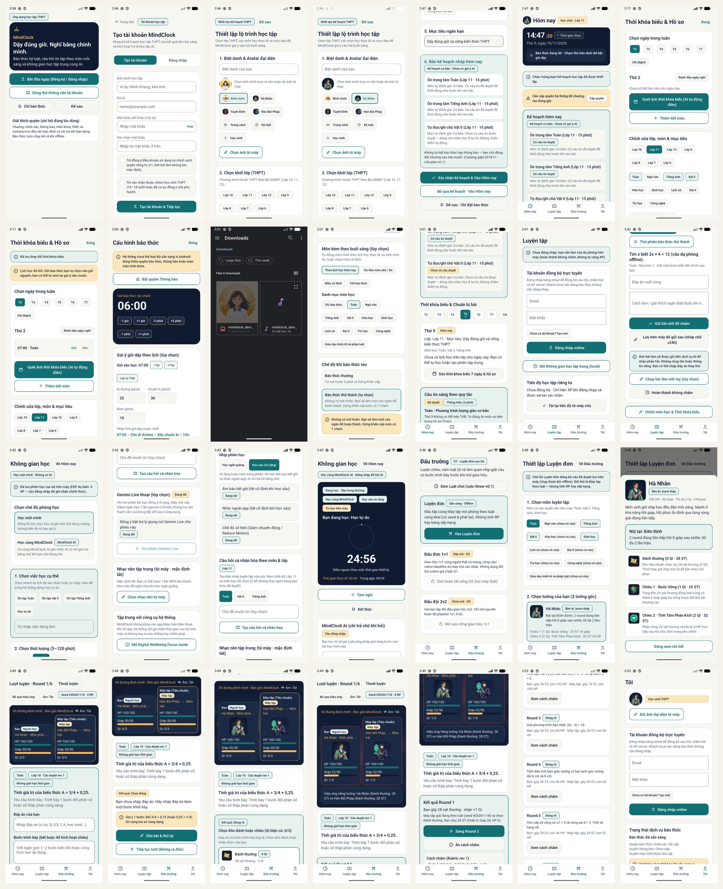

# MindClock Android — Hồ Sơ Recap Đầy Đủ, Ảnh Giao Diện & Video Demo Thực Tế

- **Ngày kiểm chứng & ghi hình:** `2026-11-19`
- **Bản build chạy thử:** `app/build/app/outputs/flutter-apk/app-debug.apk` (`com.mindclock.app`) trên **Android Emulator `Medium_Phone_API_37.0` (1080×2400)** nối tới **Docker FastAPI + PostgreSQL 16 (`http://127.0.0.1:8000`)**.
- **Tổng quan media trong thư mục:**
  - **5 video MP4 (H.264, 30 fps):** 1 video tổng hợp full walkthrough (`00_mindclock_full_android_demo.mp4`, ~8 phút 03 giây) + 4 video chia chương theo từng nhóm tính năng.
  - **28 ảnh PNG gốc (`1080×2400`) + 1 ảnh lưới tổng quan (`00_all_screens_overview.jpg`)** chụp trực tiếp từng màn hình, hộp thoại Android SAF và các trạng thái quan trọng.
  - **Báo cáo chi tiết từng màn hình & đối chiếu UI:** [`ui_features_recap.md`](ui_features_recap.md).
  - **Báo cáo test Game Đấu trường G1 trên Emulator & cập nhật T056:** [`game_emulator_test_report.md`](game_emulator_test_report.md) (kèm ảnh mới `11`, [`29_android_launcher_icon.png`](screenshots/29_android_launcher_icon.png), [`30_app_launch_splash.png`](screenshots/30_app_launch_splash.png)).

> [!IMPORTANT]
> **Minh bạch hiện trạng theo quy tắc dự án (`AGENTS.md §3`):** Toàn bộ ảnh và video dưới đây ghi trực tiếp từ ứng dụng Android thật chạy trên **emulator `Medium_Phone_API_37.0`**. Emulator giúp xác nhận luồng UI, điều hướng, SAF file picker, Đấu trường G1 và hợp đồng Kotlin/Flutter; trước khi phát hành người dùng thật vẫn cần chạy bổ sung checklist **2 máy Android vật lý** (màn khóa, kill app, reboot, DND theo OS, pin/background, giọng nói) và **staging Firebase Auth thật**.

---

## 1. Thư viện Video Demo (`videos/`)

| File Video | Thời lượng | Dung lượng | Nội dung chính |
| --- | --- | --- | --- |
| [`videos/00_mindclock_full_android_demo.mp4`](videos/00_mindclock_full_android_demo.mp4) | `483.5s` (`08:03`) | `21.17 MB` | **Video tổng hợp đầy đủ 4 chương** từ màn Chào mừng -> Onboarding/Avatar -> TKB & Báo thức MP3 -> Luyện tập & Không gian học -> Đấu trường G1 công bằng -> Tab Tôi. |
| [`videos/01_onboarding_and_dashboard.mp4`](videos/01_onboarding_and_dashboard.mp4) | `87.8s` (`01:28`) | `3.14 MB` | **Chương 1:** Màn Chào mừng giải thích quyền không ép bật popup -> Màn Đăng ký/Đăng nhập THPT -> Chọn Avatar minh họa (`Bình minh`, `Hà Nhân`, `Tuyệt Đỉnh`, `Hàn Bội Pháp`) & nút chọn ảnh máy -> Lớp 11 + môn chuẩn GDPT 2018 -> Kế hoạch nháp `rule-plan-v0.1` -> Dashboard `Hôm nay`. |
| [`videos/02_timetable_and_alarm_config.mp4`](videos/02_timetable_and_alarm_config.mp4) | `117.7s` (`01:58`) | `4.66 MB` | **Chương 2:** Dashboard -> `Đặt báo thức` -> Tính giờ dậy gợi ý (`07:00 - 25 - 30 - 10 = 05:55`, cần bấm `Dùng giờ này`) -> Chọn `Nhạc từ máy của bạn` -> Mở **Android SAF (`DocumentsUI`)** chọn `mindclock_demo_ringtone.mp3` -> `Nghe thử chuông` / `Dừng nghe thử` -> Bật `Báo thức thử thách` (rõ thông báo không Hoãn, vẫn có Dừng khẩn cấp 1 chạm) -> Lưu cấu hình. |
| [`videos/03_practice_and_study_space.mp4`](videos/03_practice_and_study_space.mp4) | `103.9s` (`01:44`) | `6.35 MB` | **Chương 3:** Tab `Luyện tập` -> Thử phiên báo thức thử thách (nháp 24h, chụp bài làm tùy chọn, câu dự phòng offline) -> `Không gian học`: tách biệt `Học một mình` (không AI) vs `Học cùng MindClock` (`MindClock AI` gắn nhãn + `Gemini Live` tắt mặc định + card `Nhạc nền từ máy`) -> chuyển `Học sâu (im lặng)` tự khóa cứng nhạc nền & âm báo/nhắc ngoài app -> chạy đồng hồ đếm ngược thực tế -> `Kết thúc` & `Lưu phiên`. |
| [`videos/04_arena_g1_and_profile.mp4`](videos/04_arena_g1_and_profile.mp4) | `174.2s` (`02:54`) | `7.03 MB` | **Chương 4:** Tab `Đấu trường` -> Hub công bằng (`Luyện đơn` mở, `1v1` khóa G2, `2v2` khóa G3) -> Mở modal xem trước **Nội tại & bộ 3 chiêu thức** của `Hà Nhân` -> Vào trận trên sân `Võ đường Bình minh` -> Chấm bài với câu chưa đạt (`Gợi ý 1 bước` + `Sửa bài & thử lại`, không trừ oan) -> Giải đúng 6 round liên tiếp (`0.75+0.25`, đạo hàm, phương trình, tam giác vuông, cấp số cộng) -> `Xem cách chấm (Rubric rev 1)` -> Xem hồi đáp HP/Giáp/Qi -> Màn tổng kết trận (`0 RP`) -> Tab `Tôi`. |
| [`videos/05_t057_to_t061_new_features_demo.mp4`](videos/05_t057_to_t061_new_features_demo.mp4) | `20s` | `0.29 MB` | **Cập nhật T058–T061 (build 152.35 MB):** Màn Chào mừng chặt (không còn nút Guest, giữ offline khẩn cấp) -> Màn Đăng ký bắt buộc Mật khẩu mạnh & Chính sách v2026-11; kèm ảnh [`16_t058_strict_welcome.png`](screenshots/16_t058_strict_welcome.png), [`17_t061_welcome.png`](screenshots/17_t061_welcome.png), [`18_t061_auth_strong_pw.png`](screenshots/18_t061_auth_strong_pw.png). |
| **Ảnh kiểm chứng APK T062/T063 (`2026-11-20`)** | `4 ảnh PNG` | `152.37 MB APK` | Chạy thật trên `emulator-5554`: [`19_t063_apk_launch.png`](screenshots/19_t063_apk_launch.png) (Splash), [`20_t063_practice_clean_ui.png`](screenshots/20_t063_practice_clean_ui.png) (Luyện tập không còn chữ Demo/Thử phiên + bàn phím Toán), [`21_t063_arena_hub.png`](screenshots/21_t063_arena_hub.png) (Hub Đấu trường G1/G2/G3), [`22_t063_arena_timer_setup.png`](screenshots/22_t063_arena_timer_setup.png) (Setup chọn timer 30s/45s/60s/90s). |

---

## 2. Tổng hợp Bất Biến: Mượt Mà · Công Bằng · Trực Quan · An Toàn

| Trụ cột | Cơ chế đã kiểm chứng trên App Android | File bằng chứng |
| --- | --- | --- |
| **Mượt mà & phản hồi rõ** | Đồng hồ `Thời gian thực` nhảy từng giây trên Dashboard; chuyển tab dưới 4 cửa (`Hôm nay`, `Luyện tập`, `Đấu trường`, `Tôi`) giữ trạng thái sạch; gõ bàn phím Gboard, ẩn IME và cuộn mượt qua 6 round combat không rớt khung hình hay tràn layout `1080×2400`. | [`06_today_dashboard_initial.png`](screenshots/06_today_dashboard_initial.png), [`18_study_space_running_timer.png`](screenshots/18_study_space_running_timer.png), [`25_arena_round_feedback.png`](screenshots/25_arena_round_feedback.png) |
| **Công bằng học thuật & thi đấu** | **1)** Đáp án & bước trình bày bắt buộc **chỉ dùng để mở chiêu** — sai/chưa chắc có gợi ý 1 bước và nút `Sửa bài & thử lại` hoặc đổi câu không mất HP oan; **2)** Chiêu thức khóa hiển thị rõ lý do (`Thiếu Qi: cần 1, đang có 0`); **3)** Rubric chỉ mở *sau khi nộp* (`Xem cách chấm`); **4)** Luyện đơn tách bạch `0 RP / Không xếp hạng`, không tạo bot giả danh người thật hay mở khóa G2/G3 khi chưa đạt cổng máy thật. | [`19_arena_hub_modes.png`](screenshots/19_arena_hub_modes.png), [`21_arena_champion_detail_modal.png`](screenshots/21_arena_champion_detail_modal.png), [`23_arena_uncertain_no_penalty.png`](screenshots/23_arena_uncertain_no_penalty.png), [`26_arena_rubric_revealed.png`](screenshots/26_arena_rubric_revealed.png) |
| **Trực quan & thẩm mỹ thống nhất** | Palette giấy ấm – xanh đêm – điểm nhấn cam bình minh thống nhất (`RAW_COLOR_HITS: 0`), không dùng emoji hệ thống, dùng hoàn toàn icon vector nét mảnh + 12 asset minh họa gốc đội tự tạo (`avatar_sunrise.png`, 3 chân dung tướng, 7 icon chiêu, map `map_courtyard.png`), chữ tiếng Việt THPT rõ ràng. | [`00_all_screens_overview.jpg`](screenshots/00_all_screens_overview.jpg), [`03_onboarding_avatar_presets.png`](screenshots/03_onboarding_avatar_presets.png), [`24_arena_action_skill_picker.png`](screenshots/24_arena_action_skill_picker.png) |
| **An toàn, riêng tư & ngoại tuyến** | Báo thức chạy local không phụ thuộc Auth hay mạng; SAF copy file ảnh/MP3 vào thư mục riêng `filesDir` của app không xin quyền bộ nhớ diện rộng, và `AlarmRingService` có **fallback tự động** về `BUNDLED_BERMUDA`/`SYSTEM_DEFAULT` nếu file MP3 tùy chọn bị xóa; Tab `Tôi` báo trung thực trạng thái từng quyền OS (`Đã cấp` vs `Chưa cấp` Thông báo); `Học sâu (im lặng)` khóa cứng nhạc nền & nhắc ngoài app; cam/mic mặc định tắt. | [`01_welcome_permissions.png`](screenshots/01_welcome_permissions.png), [`10_alarm_saf_audio_picker.png`](screenshots/10_alarm_saf_audio_picker.png), [`17_study_space_deep_silent_locked.png`](screenshots/17_study_space_deep_silent_locked.png), [`28_me_profile_avatar_and_permissions.png`](screenshots/28_me_profile_avatar_and_permissions.png) |

---

## 3. Bộ Số Liệu Kiểm Chứng Kỹ Thuật

| Hạng mục kiểm thử | Lệnh / Môi trường | Kết quả thực tế |
| --- | --- | --- |
| **Static Analysis (`flutter analyze`)** | `.\.local-sdk\flutter\bin\flutter.bat analyze --no-pub` | **0 issues** (`No issues found!`) |
| **Flutter Unit & Widget Tests** | `.\.local-sdk\flutter\bin\flutter.bat test --no-pub -j 1` | **82/82 PASS** (`0 failed`, gồm T047–T055) |
| **Android Kotlin Native Unit Tests** | `.\gradlew.bat testDebugUnitTest --no-daemon` (Studio JBR) | **10/10 `:app` tests PASS** (`AlarmSoundResolverTest` 4/4 gồm custom MP3 + fallback, `AlarmOccurrenceCalculatorTest` 3/3, `AlarmRingPrivacyAndStateTest` 3/3), `BUILD SUCCESSFUL` |
| **Theme & Asset Integrity** | PowerShell `Color(0x` scan ngoài `mindclock_theme.dart` | **`RAW_COLOR_HITS: 0`** |
| **Android APK Debug Live Demo** | `app-debug.apk` trên `emulator-5554` (`Medium_Phone_API_37.0`) | Cài & chạy trọn 4 chương UI, SAF audio picker, StudySpace, Arena G1 6 round không crash |
| **Backend Live Container Check** | `GET http://127.0.0.1:8000/v1/health` (Docker `api-api-1` + `api-postgres-1`) | `{"status":"ok","dbReady":true,"dbDialect":"postgresql","geminiConfigured":true,"geminiPrimaryModel":"gemini-3.8-flash"}` |
| **Docs & Task Hygiene** | `python scripts/check_docs_links.py` & `check_task_records.py` | **PASS** (543 file Markdown, 0 broken links) |

---

## 4. Ảnh Lưới Tổng Quan 28 Màn Hình

Xem phân tích chi tiết từng ảnh `01` → `28` tại [`ui_features_recap.md`](ui_features_recap.md).
